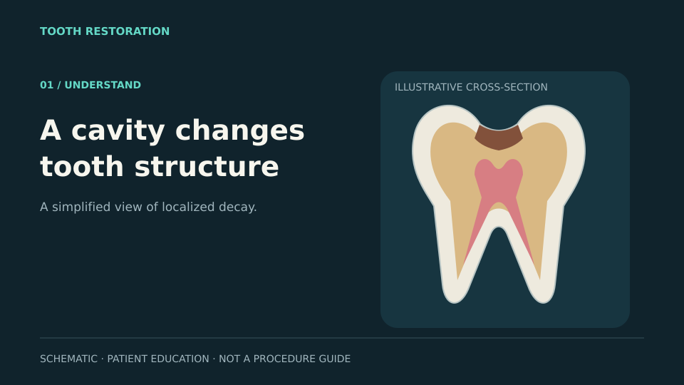

# A cavity changes tooth structure

**Common comparison preview:** 12 seconds, 960 × 540, four equal 3-second beats, silent. Same vector schematic, wording and timing for Remotion, HyperFrames and Manim. **Production target:** 45–60 seconds. **Related issue:** [#217](https://github.com/qianyizhang/med-assets/issues/217).

| Preview time | Picture / motion | Draft voiceover for production expansion | On-screen words |
|---|---|---|---|
| 00–03 | Schematic molar section with a bounded brown lesion; do not extend the lesion into pulp. | “Repeated acid attacks can damage tooth structure. Early decay and an established cavity are not the same.” | A cavity changes tooth structure |
| 03–06 | Pause and highlight the lesion. Show an assessment card, not an automatic treatment decision. | “A dental assessment determines whether prevention, restoration or another approach is appropriate.” | Assess and plan · Treatment depends on assessment |
| 06–09 | A distinct prepared state replaces the lesion; restoration then appears. Do not show bur angles, depth settings or an invented operative technique. | “When a restoration is indicated, the dentist prepares the affected area and restores the tooth.” | Prepare and restore |
| 09–12 | Hold the restoration, then show review and prevention cards. | “The restoration still needs care and review. Fluoride and cleaning help protect the remaining tooth.” | Review and protect |

**Clinical wording sources:** [NIDCR: tooth decay](https://www.nidcr.nih.gov/health-info/tooth-decay) distinguishes early reversible decay from cavities and describes fillings; [FDA: treatment options](https://www.fda.gov/medical-devices/dental-amalgam-fillings/treatment-options-dental-caries) describes restorative options and composite materials. Wording is intentionally high-level. These sources do not validate the schematic tooth geometry or a specific preparation design.

**Asset boundary:** The current exterior atlas and 35–37 support crown relief are not suitable substitutes for a validated restorative molar. The FDI31 prepared specimen is an incisor, not the molar in this storyboard. No disease state is inferred from exposed atlas roots or source omissions.

**Rig work:** one source-qualified molar with separate enamel/dentin/pulp surfaces; reviewed lesion volume and preparation/restoration states; reversible visibility; isolate mode; safe-area labels; camera path and return-to-baseline. Layer masks must not intersect pulp unintentionally. Curing is material-specific and requires an approved protocol if added later.

**Material work:** matte identification mode first, then a restrained enamel look; distinguish the lesion from shadows; visibly mark the restoration boundary; avoid implying that filling colour establishes material or disease severity.

**Acceptance before filming:** clinician-approved disease and treatment scope, source rights, morphology and scale; validated state transitions and persistent tissue relationships; no unsupported treatment guarantee. The current GIFs test storytelling and framework workflow only.

## Review artifact

The canonical 12-second script and common-design assets are shared by all three framework comparisons. Individual GIF/MP4 previews and the reproducible framework sources are delivered separately; this PR retains the locked storyboard and a lightweight inspectable SVG poster, without duplicating those render outputs. No existing clinical asset is relabelled or modified.

The prototype sequence visibly separates an empty preparation from the filling. Geometry is an authored vector schematic and remains clinically unvalidated. The full operative sequence, tool detail, technique and timing are intentionally outside this patient-education proposal.

References #217 without closing it. The issue still needs dedicated source anatomy, approved disease states, rig controls and clinical review.

## Reproduce the common assets

Run `python3 docs/dental-animation/caries-restoration/build_assets.py` with Python 3.11+. It regenerates the shared vector layers and storyboard without third-party packages. The retained SVG layers are the common runtime inputs; `poster.svg` is a composed review frame. Frame rendering for each framework is in the separately delivered comparison source bundle.
