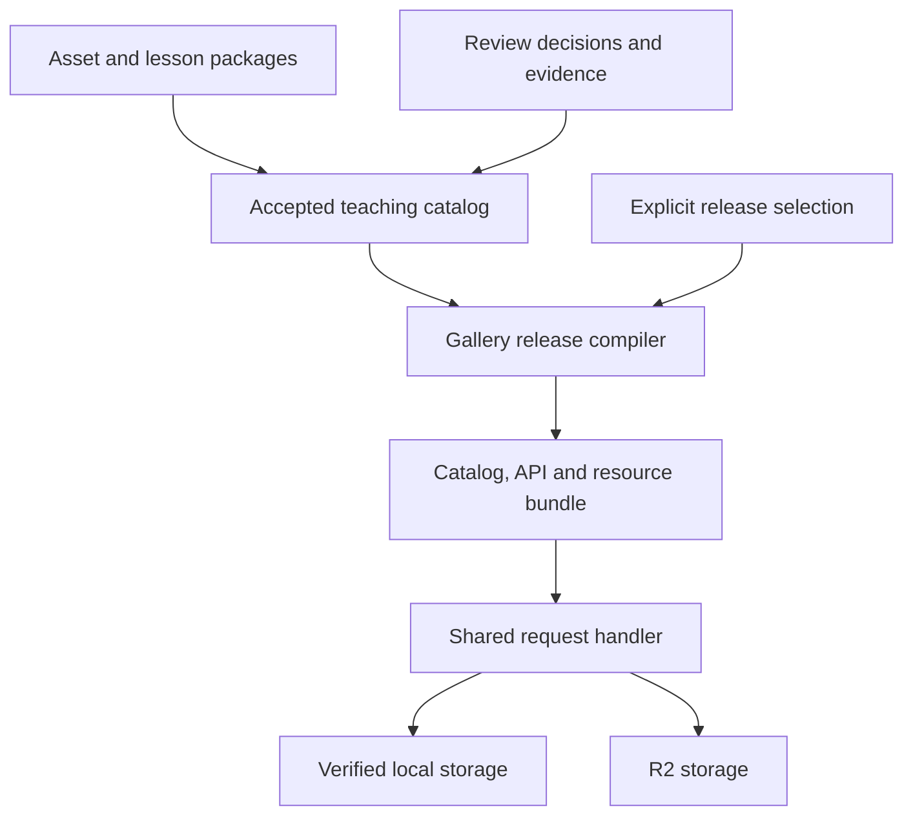

## Assessment

**The first round fixed real correctness problems. The repository is safer, but the structural simplification is unfinished.** Explicit selections, stronger verification, and bounded upload plans now exist. Several older reconstruction and orchestration paths still sit underneath them.

I reviewed `main` at [aa2d63c](https://github.com/qianyizhang/med-assets/commit/aa2d63c2d2faad5c7f26f10c0512f90dd812eac5), compared it with the previously audited `e613024`, surveyed the tracked tree, and reran verification.

My recommended destination is:

> **Package-owned assets and recipes, a small shared asset toolkit, one accepted-teaching model, and one Gallery compilation and delivery path.**

That would give your three principles concrete meaning:

- **Pruning:** retire superseded implementations and reproducible artifacts as their consumers migrate.
- **Deep modules:** hide identity, acceptance, geometry, and release invariants behind small interfaces.
- **Executable governance:** make the ordinary commands enforce those invariants, with skills explaining the judgment that remains.

A consolidated `lib/med_assets` is justified. Its value should be measured by the duplicated logic, reverse dependencies, and manual editing steps it eliminates.

---

## 1. What the first round actually fixed

The earlier findings should not be carried forward unchanged.

| Area | Current assessment |
|---|---|
| Shallow-checkout verification | **Fixed.** The entire offline gate passed in a fresh depth-one, LFS-pointer checkout. |
| Scorecard dependence on generated display caches | **Fixed for metadata verification.** Declared display bindings now resolve against their tracked source identities. |
| Markdown determining active selections | **Fixed.** Structured selections own the current register; Markdown is generated. |
| Separate current-assessment decisions in Gallery and coverage | **Improved substantially.** Both use `CurrentTeaching`. |
| Current Gallery tests missing from ordinary CI | **Fixed.** The portable Gallery Node suites now run through the offline verifier. |
| Retained delivery catalog preventing a bounded upload | **Fixed.** Upload plans are separate from the permanent route catalog. |
| Runtime hostname determining candidate/public selection | **Fixed in current UI source.** Selection is now a build input. The serving boundary still needs work. |
| Bootstrap and recipe ownership | **Improved.** There is a supported Gallery bootstrap, and the right-arm and pelvis promotions are real. Other active recipe dependencies remain. |

These changes are visible in the [offline verifier](https://github.com/qianyizhang/med-assets/blob/aa2d63c2d2faad5c7f26f10c0512f90dd812eac5/tools/verify.py), [current teaching resolver](https://github.com/qianyizhang/med-assets/blob/aa2d63c2d2faad5c7f26f10c0512f90dd812eac5/tools/maintained_teaching.py), and [bounded upload planner](https://github.com/qianyizhang/med-assets/blob/aa2d63c2d2faad5c7f26f10c0512f90dd812eac5/transport/tools/r2_migration.py).

### Verification I completed

The ordinary checkout and a fresh shallow checkout both passed:

- **462 Python tests**
- **3 current Gallery Node suites**, containing 15 tests
- Maintained register and scorecard checks
- 26 transport manifests
- 25 foundation records
- 394 import references
- 1,147 LFS pointer identities

I also checked a real, scoped upload plan against the current delivery catalog. The uploader’s preflight accepted one selected tracked file without transferring anything or changing retained routes.

### The simplification accounting

These are logical tracked-file sizes, counting LFS pointers at pointer size—not Git database size or hydrated media size.

| Measure | Previous audit | Current HEAD | Change |
|---|---:|---:|---:|
| Tracked files | 3,658 | 3,684 | **+26** |
| Tracked Git-file contents | 50,723,900 bytes | 51,170,256 bytes | **+446,356 bytes** |
| LFS object identities | 1,147 | 1,147 | Unchanged |
| Declared LFS payload bytes | Approximately 1.113 GB | Approximately 1.113 GB | Unchanged |

The two new structured selection/assessment inputs account for **324,001 bytes**, about 73% of the tracked growth. Those contracts have a purpose. They now need to replace the older machinery they make unnecessary.

The campaign records separate cleanup of a duplicated 327-file rehearsal and more than 6 GB of temporary verification trees. I did not independently reproduce those local cleanup measurements. They are distinct from the tracked-tree growth above. [Comparison](https://github.com/qianyizhang/med-assets/compare/e6130242249ef505afc0e5237a2461e8049c64f8...aa2d63c2d2faad5c7f26f10c0512f90dd812eac5) · [Campaign acceptance](https://github.com/qianyizhang/med-assets/blob/aa2d63c2d2faad5c7f26f10c0512f90dd812eac5/records/campaigns/maintained-state/README.md)

---

## 2. What the refactored repository should look like

### A. Asset ownership should determine where things live

The existing top-level ownership model is mostly sensible:

- Models own individual assets and their current recipes.
- Assemblies own composition and registration.
- Lessons own teaching sequences, views, and lesson-specific plates.
- Reviews own observations, decisions, and evidence.
- Sites consume and present those things.
- Transport owns delivery and recovery.

The major unfinished work is enforcing those boundaries. Current rebuilds still reach into dated review campaigns; lesson renderers still reach into Gallery content; generic recovery helpers import Gallery orchestration.

A wholesale rename of `body/`, `heart/`, or every recipe directory would produce migration work with little immediate benefit. Finish ownership at the executable boundaries first. The repository’s [workflow ownership table](https://github.com/qianyizhang/med-assets/blob/aa2d63c2d2faad5c7f26f10c0512f90dd812eac5/docs/WORKFLOW.md#ownership) already supports this direction.

### B. Introduce a small importable toolkit

I would organize the shared Python code under **`lib/med_assets`**, with ordinary package configuration and thin command entry points.

These are proposed responsibilities and interfaces, not commands that already exist:

| Module | Small public interface | Complexity it should own |
|---|---|---|
| **Artifacts** | `declared_identity`, `verify_payload`, `install_verified` | Repository paths, LFS declarations, actual byte verification, safe installation, explicit derivative bindings |
| **Teaching** | `validate_current`, `selected`, `gallery`, `promote` | Stable identities, accepted assessments, evidence bindings, pins, selection changes, generated views |
| **GLB operations** | `read`, `select`, `repack`, bounded comparison operations | Shared container/accessor handling, exact selection, common repacking, supported-format restrictions |
| **Rendering** | Scene setup, matched views, plate composition | Repeated camera/light/output mechanics; Blender dependencies remain isolated here |
| **Gallery catalog and release** — JavaScript, owned by the site | `compileCatalog`, `compileRelease` | UI-ready records, recommendations, aliases, selected resource dependencies |
| **Delivery** — retain the existing extracted core | `handle(request, storage)` | Request semantics, route admission, ranges, caching, missing-object behavior |

The Python toolkit should be usable without importing Gallery or initializing Blender. Provider endpoints, publication policy, anatomical judgments, and asset-specific tolerances belong with their respective owners.

“Deep” describes how much complexity an interface hides. It does not require a separate `deepmodules/` hierarchy. A useful module should let a caller perform a meaningful operation without knowing its internal metadata encoding.

For example, **promoting an accepted review** is a deep operation. Computing a digest, editing two indexes, constructing three kinds of overlay, and regenerating two documents should be internal details of that operation.

### C. Current state should be directly consumable

There should be one authoritative representation of:

- Which asset/task combinations are current.
- Which accepted review applies to each.
- Which revision is maintained or recommended.
- Which alternatives remain explicitly available.
- Which resources belong to a release.

Historical reviews can remain referenced as immutable evidence. Current consumers should not infer today’s choices by walking campaign chronology, interpreting paths, or replaying a series of decisions.

The new `CurrentTeaching` work moves in this direction. The next step is to finish both its **writer interface** and the Gallery’s **compiled consumer interface**.

### D. A Gallery release should contain a complete, consistent bundle

The compiler should produce the UI catalog, API data, and resource manifest together.



Local and deployed serving should exercise the same selected routes and request behavior. Storage access is the environment-specific part.

Publication remains a separate operation. Compiling a complete candidate does not require uploading or publishing it.

### E. Scaffolding should reduce decisions and repeated files

A normal asset package should declare the minimum needed to rebuild and verify it:

| Declaration | Purpose |
|---|---|
| Inputs and identities | Know exactly what the recipe consumes |
| Output role and identity/equivalence contract | Know what must remain unchanged |
| Recipe entry point and runtime | Rebuild through a supported operation |
| Check entry point | Verify the relevant guarantees |
| Views or lesson parameters, where applicable | Keep presentation inputs with the owner |
| Source/license and review references | Preserve provenance and bounded claims |

Use existing package contracts where they already contain this information. Avoid placing another manifest alongside them containing the same facts.

A simple asset should not acquire ten template files. A new ordinary asset should mostly add **data, parameters, evidence, and a test case**. It should reuse hashing, GLB handling, rendering setup, download verification, and browser-test infrastructure.

### F. Skills should remain thin

Two workflow skills would be enough to start:

1. **Asset development and review:** choosing representative views, assessing geometry and teaching tradeoffs, running the owner’s rebuild/check operations, and preparing an accepted review.
2. **Maintenance and release:** interpreting dependency/retention reports, selecting representative replays, inspecting semantic release changes, and applying the supported release workflow.

The existing simplification skill can cover much of the second workflow.

Skills should invoke executable operations. They should not teach contributors how to manually calculate pins, maintain parallel indexes, or remember rules that code can enforce.

---

## 3. Prioritized issues and fixes

**P1 means close before relying on the next release candidate. P2 means the main simplification work. P3 means conditional retirement once its remaining consumers or recovery obligations are resolved.**

### 1. P1 — The ordinary gate does not validate the whole current Gallery catalog

There are **130 current Gallery assessment records**, of which **81 are maintained selections**. The scorecard checks the selected set. The other 49 current alternatives are resolved later during Gallery assembly.

I tested this in a temporary clone:

1. Changed the accepted digest of the unselected original `Anatomy_Workshop.blend`.
2. Ran the entire offline gate.
3. The gate still passed all 462 Python tests, the Gallery suites, and the register/scorecard checks.
4. Resolving `CurrentTeaching(...).gallery()` failed with `Accepted assessment pin differs`.

**The committed data is valid. The gate has a demonstrated coverage hole.** [Selected versus Gallery resolution](https://github.com/qianyizhang/med-assets/blob/aa2d63c2d2faad5c7f26f10c0512f90dd812eac5/tools/maintained_teaching.py#L231-L247) · [Offline gate](https://github.com/qianyizhang/med-assets/blob/aa2d63c2d2faad5c7f26f10c0512f90dd812eac5/tools/verify.py#L213-L242)

**Fix:** add a current-catalog validation operation to the existing offline gate. It should resolve every explicitly current record, while keeping the maintained scorecard as its own view.

**Acceptance:** corrupting an unselected current record’s digest, task, evidence, or view binding fails ordinary CI. Unrelated historical reviews remain outside this gate.

This is a small, high-value next commit.

### 2. P1 — Candidate preview and generated Worker still have different delivery contracts

The candidate includes the new `bronchial-first-fork.glb`. Its resource is declared in `local-delivery.json`.

However, `framework.py` copies only the public `delivery-index.json` into the manifest consumed by the generated Worker. The preview server adds candidate resources through separate routing logic.

I directly exercised the Worker-facing asset handler for the candidate bronchial route. It returned:

```json
{"error":"Unknown published asset."}
```

with HTTP **404**, before accessing storage.

The new browser release test does not close this gap: it forwards browser requests to the preview server. Its generated Worker checks cover APIs and authorization rejection, but do not fetch the selected candidate resources through that Worker. This is a candidate-build gap; it does not establish a defect in the existing public v10 deployment. [Build assembly](https://github.com/qianyizhang/med-assets/blob/aa2d63c2d2faad5c7f26f10c0512f90dd812eac5/sites/anatomy-gallery/tools/framework.py#L150-L172) · [Release verification](https://github.com/qianyizhang/med-assets/blob/aa2d63c2d2faad5c7f26f10c0512f90dd812eac5/sites/anatomy-gallery/tools/verify_release_builds.mjs#L54-L104)

**Fix:** compile the selected catalog and all resources it requires into one release bundle. Serve it through one handler with local-file and R2 adapters.

**Acceptance:** a portable integration test compiles a miniature release and requests its model, evidence image, and receipt through the actual generated Worker using fake storage. Check exact bytes, missing-object behavior, excluded routes, GET/HEAD/range handling, and denied writes.

**Subtraction:** remove the preview-only route registries and dispatch branches that the shared handler replaces.

### 3. P2 — Finish the catalog compiler and remove the old reconciliation path

The new compiler is useful, but it currently serializes the output of `libraryRows`. The browser then reads:

- The compiled projection.
- The assessment inputs.
- The dated Survey seed.
- The delivery catalog.

It reconstructs records using positional assessment references and seed rows.

That leaves the old decision machinery in place: path-derived revisions, parent-export exceptions, family-specific notes, campaign precedence, and special family merging. [Compiler](https://github.com/qianyizhang/med-assets/blob/aa2d63c2d2faad5c7f26f10c0512f90dd812eac5/sites/anatomy-gallery/tools/compile_library.mjs) · [Browser reconstruction](https://github.com/qianyizhang/med-assets/blob/aa2d63c2d2faad5c7f26f10c0512f90dd812eac5/sites/anatomy-gallery/app/src/content/gallery/selected-library.js) · [Existing reconciliation](https://github.com/qianyizhang/med-assets/blob/aa2d63c2d2faad5c7f26f10c0512f90dd812eac5/sites/anatomy-gallery/app/src/content/gallery/library-data.js)

**Fix:** compile a complete UI read model from accepted teaching records, package declarations, and release selection. Use stable IDs for associations. Keep the dated Survey as an explicit Planning/Archive input.

**Acceptance:** test the actual compiler and decoder with multi-export revisions, replacement recommendations, shared families, missing resources, reordered assessments, and candidate/public membership.

**Subtraction:** remove the current Library’s Survey-default reconstruction and the corresponding legacy merge rules.

The v10 rehearsal adapter also needs a retirement condition. It currently extracts old source and patches exact JSX strings. After the first compatible release, retain and replay an immutable release bundle, then retire that source-rewriting bridge. [Published rehearsal adapter](https://github.com/qianyizhang/med-assets/blob/aa2d63c2d2faad5c7f26f10c0512f90dd812eac5/sites/anatomy-gallery/tools/framework.py#L58-L103)

### 4. P2 — Add a supported accepted-review promotion operation

The reader side is much better. The writer side still exposes too much representation detail.

`current-assessments.json` contains 130 records across 5,645 lines. Updating accepted state can involve a base digest, effective overlays, an accepted digest, a matching selected pin, and regeneration of readable views.

The supported CLI currently renders/checks Markdown. Construction logic for accepted records and selected pins exists in a test fixture helper. [Resolver and CLI](https://github.com/qianyizhang/med-assets/blob/aa2d63c2d2faad5c7f26f10c0512f90dd812eac5/tools/maintained_teaching.py) · [Fixture construction](https://github.com/qianyizhang/med-assets/blob/aa2d63c2d2faad5c7f26f10c0512f90dd812eac5/tests/teaching_fixture.py#L16-L35)

**Fix:** expose a semantic operation: promote this reviewed export for this family/task, with this attribution and evidence, as either maintained or a retained alternative.

The operation should calculate pins, update indexes, and regenerate derived views together. Its dry run should show changes to assets, tasks, scores, evidence, exemptions, and selection.

**Acceptance:**

- Repeating the same promotion is a no-op.
- Invalid inputs leave no partial update.
- Display-label changes preserve stable identities.
- Stale bases, wrong exports, and missing evidence fail.
- Promotion does not implicitly publish.

The internal delta representation can remain initially. Contributors should not need to understand it to perform a routine update.

### 5. P2 — Remove reverse dependencies through a shared artifact-integrity module

There is a concrete dependency chain:

- `restore_legacy_dental.py` imports `gallery_runtime.verified`.
- Gallery orchestration imports assessment and teaching orchestration.
- Assessment identity imports transport helpers.
- Assessment validation eagerly loads Gallery display and delivery metadata.

This makes a small recovery operation depend on unrelated application and teaching code. Assessment derivation also partly depends on parsing a GitHub source URL. [Recovery import](https://github.com/qianyizhang/med-assets/blob/aa2d63c2d2faad5c7f26f10c0512f90dd812eac5/transport/tools/restore_legacy_dental.py#L10-L12) · [Assessment identity](https://github.com/qianyizhang/med-assets/blob/aa2d63c2d2faad5c7f26f10c0512f90dd812eac5/tools/assessment_identity.py)

**Fix:** put shared identity and verified-install operations below transport, teaching, and Gallery. Describe derivatives explicitly; let Gallery add publication addresses above that boundary.

Make **declared identity** and **verified payload** distinct operations. Reading an LFS pointer establishes a declaration; hashing hydrated bytes establishes something stronger.

**Acceptance:** a standalone asset assessment can validate without a Gallery checkout. Existing wrong-byte, linked-path, conflicting-destination, and repeat-restore behavior remains covered.

Move Gallery-specific snapshot restoration to the Gallery owner when migrating its callers. Its current placement under transport obscures what it actually owns.

### 6. P2 — Complete active recipe promotion, then prune campaign machinery

The new recipe-dependency inventory is actionable. It lists active outputs depending on campaign-owned repacking, contraction, projection, fairing, motion selection, rendering inputs, and even an experiment-owned font.

The right-arm and pelvis changes solved two cases. The remaining inventory already identifies the next work; another inventory document would add little. [Remaining active dependencies](https://github.com/qianyizhang/med-assets/blob/aa2d63c2d2faad5c7f26f10c0512f90dd812eac5/records/campaigns/maintained-state/recipe-dependencies.md)

**Fix:**

- Put selected parameters, source identities, tolerances, and intended use in each asset owner.
- Put genuinely shared algorithms in the GLB/rendering toolkit.
- Keep historical alternatives and their findings in reviews.
- Make active rebuilds independent of their campaign directories.

There are also remaining lesson ownership inversions: salivary rendering reads view definitions from Gallery source, and right-arm plate generation writes directly into Gallery content. Give lessons their own view inputs and explicit output directories; Gallery assembly should consume the results. [Salivary renderer](https://github.com/qianyizhang/med-assets/blob/aa2d63c2d2faad5c7f26f10c0512f90dd812eac5/lessons/salivary-practice/render.py#L11-L17) · [Right-arm plates](https://github.com/qianyizhang/med-assets/blob/aa2d63c2d2faad5c7f26f10c0512f90dd812eac5/lessons/right-arm-parts/plates.py#L11-L12)

**Acceptance:** rebuild through the owner entry point from declared inputs. Preserve exact bytes where promised; preserve the specified decoded geometry/pixel tolerances where that is the actual contract.

Shared parsing should not erase independent checks or asset-specific anatomical assertions.

### 7. P2 — Consolidate browser verification around behavior

There are **17 `verify_*.mjs` scripts totaling 3,654 lines** under Gallery tools.

They cover real differences, but repeat browser setup, navigation, request restrictions, download hashing, scene loading, sharing, screenshots, and receipt writing. [Gallery verification tools](https://github.com/qianyizhang/med-assets/tree/aa2d63c2d2faad5c7f26f10c0512f90dd812eac5/sites/anatomy-gallery/tools)

**Fix:** use one runner and a few behavioral suites:

- Catalog, routes, and downloads.
- Scene loading, selection, sharing, retry, and disposal.
- Layer lessons and answer recovery.
- Evidence plates and archive media.

Ordinary studies become case data. Custom tests remain where the teaching interaction is different.

**Acceptance:** migrate assertions before deleting old scripts. Preserve historical receipts independently of the implementation that produced them.

A new ordinary study should usually add a case rather than another executable verifier.

### 8. P2/P3 — Consolidate recovery and decide the supported scope of Drive sync

Two transport follow-ups remain deliberately deferred.

**Archive recovery:** the existing collection restore command verifies archives and members, while teaching-archive recovery still involves separate documented recipes. Register the existing 327-member archive and extend the current restore command with its member-manifest format and optional subset selection. Preserve the archive’s identity. [Collection restore](https://github.com/qianyizhang/med-assets/blob/aa2d63c2d2faad5c7f26f10c0512f90dd812eac5/transport/tools/restore_collection.py) · [Separate teaching recovery](https://github.com/qianyizhang/med-assets/blob/aa2d63c2d2faad5c7f26f10c0512f90dd812eac5/sites/body-systems-survey/README.md)

**Drive coordination:** three coordinator generations remain in `backup_transfer.py`, while remote full-tree sync, readback, and restore are still documented as unverified. The generation-specific implementation and test surface is roughly 1,200 lines worth reviewing. [Coordinator implementations](https://github.com/qianyizhang/med-assets/blob/aa2d63c2d2faad5c7f26f10c0512f90dd812eac5/transport/tools/backup_transfer.py) · [Verification status](https://github.com/qianyizhang/med-assets/blob/aa2d63c2d2faad5c7f26f10c0512f90dd812eac5/docs/BACKUP_CHECK.md)

**Fix:** retain the useful exact-tree checker. Either freeze sync coordination as an experiment or support one coordinator with demonstrated end-to-end recovery.

Check for real external or paused journals before deleting readers or migrations. Repository searches cannot establish that external state does not exist.

---

## 4. Where pruning will produce real gains

### Measured opportunities

| Surface | Finding | Appropriate action |
|---|---|---|
| Exact duplicate tracked blobs | **472,303 bytes** of duplicate content beyond the first copy | Review individually. Much is licenses, pinned fixtures, or required package copies. |
| Cardiac geometry JSON exports | Two files total **9,681,427 bytes**; in-memory gzip reduced them to **2,610,730 bytes** | Evaluate compressed delivery or reproducible generation after migrating readers and identity contracts. |
| Duplicated cardiac geometry inputs | `heart_geometry.py` and `vessel_geometry.json` have identical copies across the atlas and synthetic-imaging package | Establish one source owner; materialize a package copy only when standalone packaging requires it. |
| Review tree | **1,547 files**, about **42%** of tracked files | Separate active dependencies, unique evidence, and genuinely retired material before deletion. |
| Balanced Drive fallback | Three files, **189 lines / 8,870 bytes**, including an active workflow | Retire once an independent exact-byte recovery route covers its remaining obligation. |

The Cardiac JSON files have current readers and pinned export contracts. Compression is a measured possibility, not permission to remove them. It also does not imply an equivalent reduction in Git’s already-compressed storage. [Cardiac export contract](https://github.com/qianyizhang/med-assets/blob/aa2d63c2d2faad5c7f26f10c0512f90dd812eac5/heart/Cardiac_Atlas/exports/EXPORT_CONTRACT.json) · [Portable export preparation](https://github.com/qianyizhang/med-assets/blob/aa2d63c2d2faad5c7f26f10c0512f90dd812eac5/heart/Cardiac_Atlas/prepare_portable_exports.py)

The Balanced fallback is still an active workflow. Its retirement would remove an online CI and privileged execution path as well as three files, but its recovery purpose must first be covered. [Fallback implementation](https://github.com/qianyizhang/med-assets/blob/aa2d63c2d2faad5c7f26f10c0512f90dd812eac5/transport/tools/balanced_drive_fallback.py)

### Make retention explainable

The strongest pruning aid would be a read-only operation answering:

> **Why is this path retained?**

It should derive answers from existing roots:

- Current selected assessments and retained alternatives.
- Active recipe inputs.
- Published routes and comparisons.
- Licenses and source provenance.
- Unresolved defects.
- Verified recovery records.

Do not create a second manually maintained inventory of all 3,684 files.

The current 130 Gallery assessments reference **219 source paths and 274 view paths**. That is why deleting a dated review directory based only on age would be unreliable.

A pruning report can identify candidates, but deletion still needs checks for dynamic discovery, packaging, public URLs, and unique recovery value.

### Resolve the “durable scratch” ambiguity

The retention policy calls for durable outcome bundles inside ignored `.artifacts/`, and work items link some such receipts. An ignored local directory alone does not establish durable recovery.

Use a clear distinction:

- Reproducible scratch may disappear.
- Evidence required by an active claim needs a tracked record or verified archive locator, checksum, and restore operation.
- The work item retains a concise outcome and links.

This strengthens the existing [retention policy](https://github.com/qianyizhang/med-assets/blob/aa2d63c2d2faad5c7f26f10c0512f90dd812eac5/docs/WORKFLOW.md#retention) through executable recovery.

---

## 5. Executable governance and implementation order

Keep `tools/verify.py` as the ordinary entry point. Extend it with a few targeted contracts rather than creating another governance framework.

| Intended rule | Executable enforcement |
|---|---|
| Every current Gallery record is valid | Resolve the complete explicit current catalog |
| A release contains everything it selects | Compile and validate its resource dependencies; exercise the generated handler |
| Accepted-state updates stay consistent | Atomic, idempotent promotion operation with semantic dry run |
| Current recipes belong to current owners | Check declared recipe dependencies, including configured paths and invoked commands |
| Generated views match their owners | Retain register/scorecard drift checks |
| Required evidence remains recoverable | Validate tracked references or pinned archive restoration |
| Pruning reduces maintenance burden | Report file, byte, and active-entry-point changes alongside migrated consumers |

The dependency check should begin with the known active recipe graph. A regex over Python imports will miss `runpy`, subprocesses, and paths embedded in JSON.

File count and size should be explicit budgets. Report separately:

1. Tracked files.
2. Tracked Git-file contents.
3. Unique declared LFS payload bytes.
4. Release payload bytes.
5. Active commands and distinct execution paths.

A refactor should explain any increase and name the superseded implementation it removes. This makes subtraction reviewable without rewarding deletion of useful evidence.

### Suggested sequence

| Slice | Outcome | What should disappear |
|---|---|---|
| **1. Close the P1 gaps** | Whole-current-catalog validation and a consistent candidate resource contract | Verification blind spots; redundant preview routing as the shared handler takes over |
| **2. Establish artifact and teaching modules** | Clean dependency direction and supported review promotion | Cross-layer helper imports and manual pin/index editing |
| **3. Finish Gallery compilation** | Complete read model and release bundle | Survey-dependent current reconstruction, positional rehydration, and eventually the v10 source-patching bridge |
| **4. Promote recipes and consolidate verification** | Package-owned rebuilds, shared operations, behavior-based test cases | Campaign-owned active execution and duplicated per-study runners |
| **5. Prune and close recovery obligations** | Explainable retention and one supported recovery path per need | Superseded artifacts, redundant sync generations where safe, completed one-off executors |

The intended contributor experience should be simple: **declare an asset’s inputs and parameters, rebuild and check it through its owner, record a reviewed decision, promote it through one supported operation, and compile a release from explicit selection.** Routine work should stop requiring knowledge of campaign history, digest encodings, Gallery internals, or several overlapping delivery paths.

This review covered source, manifests, ownership, tracked size and duplication, portable tests, and targeted failure reproductions. I did not hydrate the full LFS collection, replay Blender recipes, rerun visual/anatomical reviews, or verify live publication and remote recovery. No repository changes were made.