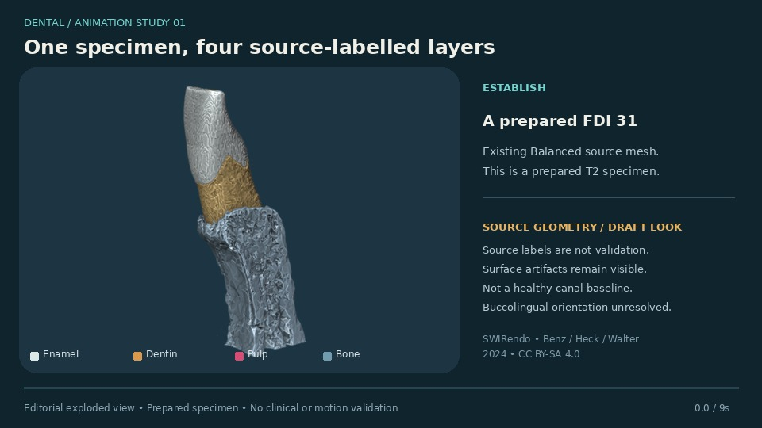
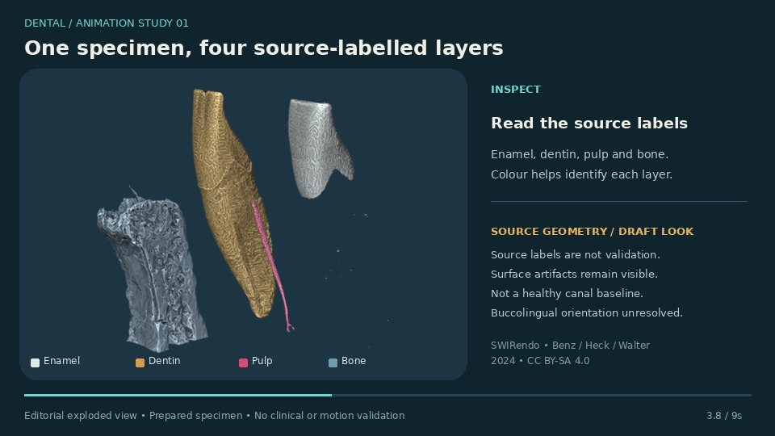

# One specimen, four source-labelled layers

**Working preview:** 9 seconds, 960 × 540, 8 fps. **Production target:** 30–40 seconds, 24/30 fps. **Related issue:** [#216](https://github.com/qianyizhang/med-assets/issues/216), with material work in [#219](https://github.com/qianyizhang/med-assets/issues/219).

**Purpose:** Explain why a tooth is more than an outer surface, then establish a reusable reveal / isolate / reset language for later tutorials.

| Production time | Picture / motion | Draft voiceover | On-screen words |
|---|---|---|---|
| 00–06 | Fixed three-quarter view of the actual FDI31 Balanced specimen. Hold long enough to orient. | “This prepared specimen lets us inspect several source-labelled layers.” | Prepared T2 specimen · FDI 31 |
| 06–15 | Move enamel and bone outward; retain the fixed camera. Show the original grouping with a faint locator in the production rig. | “Separating the layers helps us see what the outer surface normally hides.” | Editorial separation |
| 15–27 | Isolate enamel, dentin, pulp, then bone for roughly three seconds each. Restore the original placement between highlights. | “These source labels identify enamel, dentin, pulp and bone.” | Source labels, not independent validation |
| 27–36 | Reassemble to the exact initial transforms; end on source identity. | “This is a prepared research specimen, not a normal tooth or a treatment simulation.” | Back to source placement |

**Existing asset:** SWIRendo A_1_31_T2_SEG_na Balanced derivative, four source-labelled meshes. Original GLB SHA-256: `90006e54c2b9f79f6c201397a50f92228d9ad6fa4450f20e0ad20c5fe70c19f7`. Source: Benz, Heck & Walter (2024), [dataset](https://doi.org/10.5282/ubm/data.477), CC BY-SA 4.0. Preview uses the source geometry unchanged with reversible editorial object transforms and illustrative colours. Source defects and simplification artifacts remain visible. Buccolingual orientation is unresolved; the display camera does not assert anatomical orientation.

**Rig work:** reversible per-layer offsets; isolated visibility; exact reset; camera bookmarks; anchored labels that respect occlusion; exportable timeline. No soft-tissue deformation or physiology is asserted. Add matching source-pose inset and layer-by-layer holds to the production version.

**Material work:** consistent ivory/amber/magenta/slate identification palette; reduce distracting Workbench cavity shading without removing source surface defects; neutral comparison lighting; readable grayscale labels. No physically measured enamel, dentin or pulp shader claim.

**Acceptance before filming:** exact reset and source hashes pass; all source layers legible; label anchors visually verified; preserve source provenance; review prepared-specimen limits. Geometry integrity, visual quality, clinical approval and runtime acceptance remain separate gates.


## New animation states





These are two states of the new animation, not a geometry-edit before/after comparison. Camera and lighting are fixed; a small whole-group presentation turn is intentional. The requested GIF is delivered separately.

## Replay

With Blender 4.3.2 and the hydrated source GLB, run from the repository root:

```sh
blender -b -t 4 -P lessons/dental-animation/fdi31-layer-reveal/render.py -- --source models/swirendo_fdi31/exports/balanced-20261028/FDI31-balanced.glb --out lessons/dental-animation/fdi31-layer-reveal/source-frames
python3 lessons/dental-animation/fdi31-layer-reveal/compose.py
blender -b -t 2 -P lessons/dental-animation/fdi31-layer-reveal/verify_geometry.py -- models/swirendo_fdi31/exports/balanced-20261028/FDI31-balanced.glb lessons/dental-animation/fdi31-layer-reveal/fdi31-reveal.blend lessons/dental-animation/fdi31-layer-reveal/geometry-check.json
```

The compositor uses Pillow 13.0.0 and DejaVu Sans at its standard Linux path. The generated Blender scene has 72 keyframes at 8 fps; its first frame restores the source-relative grouping. Native source coordinates remain unchanged. Generated frames, GIF and Blender scene are not committed; one recipe, its geometry verification, two review states and a compact manifest are retained. The editable Blender scene is delivered in the prototype source bundle.

## Verification scope

Actual clean import comparison: all four decoded vertex-coordinate and topology hashes match the source; all child locations are equal at reset. The source SHA-256 is retained in both manifests. Readability was reviewed at source pose, separated view and reset. Source defects remain visible. The offline gate covers manifest contracts and script syntax; Blender geometry verification and rendered-frame inspection are separate. No anatomical, clinical, physiological or browser-runtime validation is claimed.
