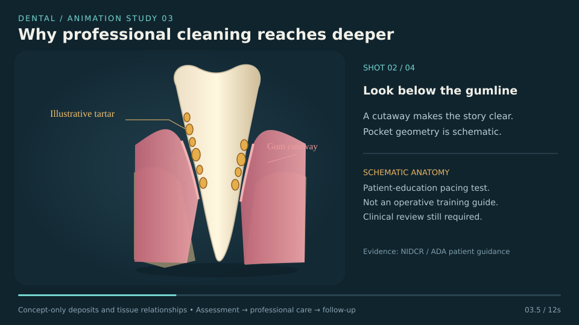

# Why professional cleaning reaches deeper

**Working preview:** 12 seconds, 960 × 540, 12 fps. **Production target:** 45–60 seconds. **Related issue:** [#218](https://github.com/qianyizhang/med-assets/issues/218), with material work in [#219](https://github.com/qianyizhang/med-assets/issues/219).

| Production time | Picture / motion | Draft voiceover | On-screen words |
|---|---|---|---|
| 00–10 | Exterior schematic, then highlight illustrated deposits above and below the gumline. | “Plaque can harden into tartar. Deposits around a tooth can contribute to inflammation.” | Plaque and tartar |
| 10–22 | Reveal a sectional gum pocket. Keep a labelled exterior locator beside the section in the production version. | “A dental professional checks the gums and supporting tissues before planning care.” | Assess first |
| 22–40 | Concept cleaning zone passes along the root; deposits fade. The current prototype deliberately omits instrument technique. | “Professional cleaning removes deposits. The approach depends on the condition of the gums and supporting tissues.” | Professional cleaning |
| 40–52 | Same gum and bone contours. Add recheck and home-care cards, without a morph to an idealized healthy state. | “Follow-up checks healing. Daily cleaning helps maintain the result.” | Reassess and maintain |

**Clinical wording sources:** [NIDCR: gum disease](https://www.nidcr.nih.gov/health-info/gum-disease); [ADA MouthHealthy: scaling and root planing](https://www.mouthhealthy.org/all-topics-a-z/scaling-and-root-planing). These support the educational sequence, not the invented geometry or a universal treatment.

**Current prototype:** authored vector schematic, no patient data and no existing anatomy falsely relabelled as disease. Amber deposits, pocket and bone display are conceptual. The cleaning marker is not a clinical tool trajectory. Bone and gum contours remain constant in all frames; no instant tissue regrowth or guaranteed cure is implied.

**Asset work:** source-qualified gingiva, periodontal pocket and deposit masks are missing. The existing 35–37 support study may become a separately labelled reference insert, but its synthetic PDL and cut bone do not establish periodontal disease. It currently has no gingiva.

**Rig work:** deposit-mask visibility, sectional reveal, occlusion-aware labels, clinician-reviewed instrument contact constraints for a later operative version, exact reset, hold/step controls. Do not build physically suggestive cleaning angles or forces until the intended procedure and reviewer are defined.

**Material work:** readable plaque/calculus separation, stable gum palette, restrained highlights, labels that remain clear without colour. Keep bone and PDL provenance distinct.

## Replay and review

Run `python3 -m pip install cairosvg==2.9.1 Pillow==13.0.0`, then `python3 lessons/dental-animation/periodontal-cleaning/render.py`. Output is a 12-second, 144-frame GIF; its visual colours are illustrative. The source SVG generator is canonical. The requested GIF is delivered separately to the user. Retain one static SVG poster in the repository as a lightweight inspectable frame; frame sequences and GIFs are generated and are not committed. No clinical source assets are changed.

Technical checks cover deterministic stage text, SVG parseability, fixed tissue outlines and deposit opacity bounds. Visual review covers four representative frames and timeline. No browser runtime, clinical anatomy, physical instrument or treatment-outcome validation is claimed. References #218 without closing its anatomy/rig acceptance.
