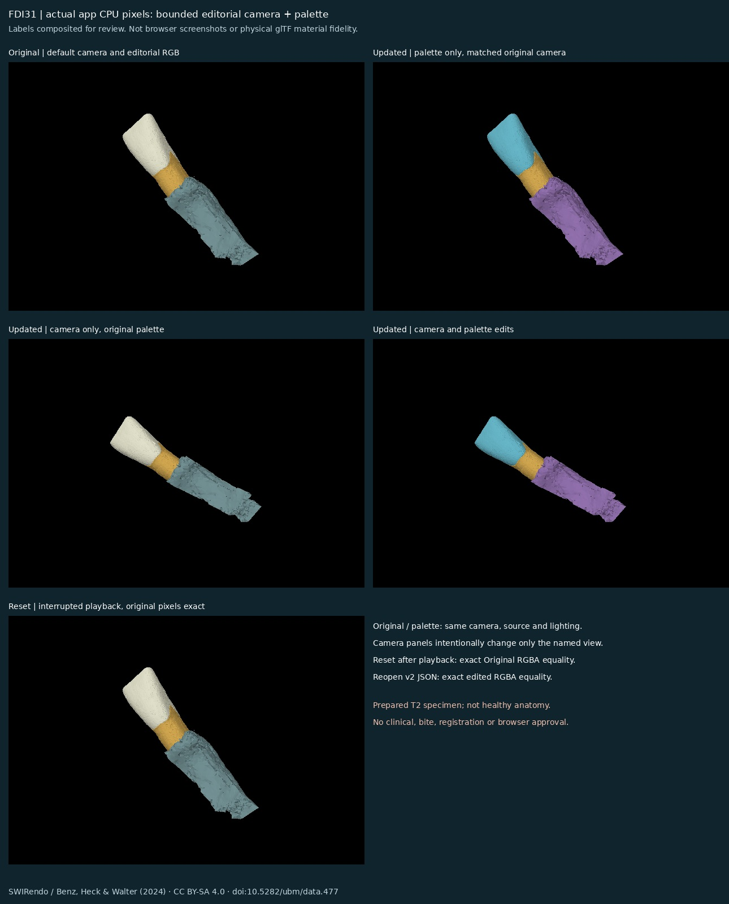

# Dental layer controls

- **Outcome** · Portable Canvas2D viewer for the pinned prepared FDI31 specimen. Reveal, isolate and reset four source-labeled layers. Edit an editorial shot, camera and opaque palette. [Issue #216](https://github.com/qianyizhang/med-assets/issues/216).
- **Deliverable** · Self-contained HTML and source-bound JSON. [Blender shooting script](../dental-animation/fdi31-layer-reveal/README.md) is a separate deliverable.
- **Coverage** · Source-bound CPU state, rendering and failure checks. Supported-browser behavior, accessibility, performance and clinical use remain unverified.



## Controls and script contract

| Goal | Result |
| --- | --- |
| Inspect layers | Absolute 0–1 reveal. Isolate by exact label. Show all preserves reveal. The baseline camera fits source and full reveal independently of selection. |
| Play a shot | Default eight-second source → separation → pulp isolation → restored source. Custom scripts use at least two strictly increasing millisecond keyframes starting at zero. Each carries reveal and isolation. Interpolate reveal, hold isolation to the next frame. |
| Interrupt playback | Scrub pauses. Pause samples the clock. Manual controls preserve the cursor, and Play reapplies the script at that cursor. End stops playback. Play then restarts from zero. |
| Edit the view | Separate static editorial camera and opaque RGB values. Yaw ±π, pitch ±π/2, zoom 0.5–1.5 and target offsets ±0.25 of the fitted extent. Resize refits and reapplies relative offsets. Edited views can crop. Valid edits pause at the last committed sample. |
| Reset all | Stop, return to zero and restore copied source transforms, visibility, camera and colors. Queued callbacks read current state. |
| Save/reopen | `window.dentalAuthoring.save()` records the last committed state and cursor. `load(jsonText)` validates on a fresh controller and reopens paused. JSON v2 adds editable `viewState`, with immutable `presentation` and derived `recordedView`. V1 loads with defaults and saves as v2. |
| Reject invalid input | Bad embedded bytes, missing Web Crypto or setup failure leave controls disabled. Invalid live scripts or view edits preserve prior state and playback. See [authoring validation](authoring.js). |

- **Generic controller** · [Controller](controller.js) takes exact unique source labels and finite editorial offsets, with copied inputs. [BP3D real-source smoke test](bp3d-source.test.cjs) checks 28 teeth and two gingiva nodes from the [pinned BP3D source](bp3d-source.json). Zero offsets exercise named selection and reset in its native frame.
- **Scope** · FDI31-specific GLB parsing and JSON interchange. Editorial colors and positions. Animated GLB export, rigging, tissue deformation, source material editing and save/load buttons are outside the current deliverable.

## Replay and checks

**Inputs** · Python 3.11+, Node.js 18+, exact hydrated source GLBs and a fresh output. Pillow for review compositing. HTML embeds the unchanged source and scripts.

```sh
PACKAGE=lessons/dental-layer-controls
SOURCE=models/swirendo_fdi31/exports/balanced-20261028/FDI31-balanced.glb
python3 "$PACKAGE/build.py" --source "$SOURCE" --out "$fresh_html"
node "$PACKAGE/script.cjs" create "$SOURCE" "$fresh_script"
node "$PACKAGE/script.cjs" check "$SOURCE" "$fresh_script"
python3 "$PACKAGE/build.py" --source "$SOURCE" --script "$fresh_script" --out "$fresh_script_html"
DENTAL_SOURCE="$SOURCE" BP3D_SOURCE="$bp3d_glb" node --test "$PACKAGE"/*.test.cjs
```

| Check | Evidence |
| --- | --- |
| Current view edits | [Review receipt](review.json) and [presentation frames](presentation-frames.json). Actual app/parser/CPU pixels with composited labels. Source/palette panels match camera and lighting. Reset restores original pixels after interruption. |
| Historical manual controls | [Preview GIF](media/FDI31-reveal-isolate-reset.gif), [frame states](preview-frames.json), [FDI31 receipt](review-fdi31-baseline.json), [named controller](review-named-baseline.json). |
| Historical timed and JSON increments | [Timeline](review-timeline-baseline.json), [UI](review-ui-baseline.json), [authoring](review-authoring-baseline.json). Receipt hashes bind their original revisions. |
| Browser acceptance | Confirm file/origin support, controls and playback, reset and reopen, fail-closed errors, focus and narrow layout. Historical cloud access to workspace HTTP was blocked and file URLs were disallowed. |

```sh
DENTAL_SOURCE="$SOURCE" node "$PACKAGE/render_presentation.cjs" "$fresh_evidence"
python3 "$PACKAGE/compose_presentation.py" "$fresh_evidence" "$fresh_review_image"
```

## Source, rights and retention

- **Source** · [FDI31 Balanced](../../models/swirendo_fdi31/exports/balanced-20261028/README.md), prepared T2 specimen A_1_31_T2_SEG_na. Buccolingual orientation unresolved. Enamel, dentin, pulp and bone are source labels.
- **Attribution** · Benz, Heck and Walter (2024), SWIRendo, [dataset DOI](https://doi.org/10.5282/ubm/data.477). Source and derived renders under [CC BY-SA 4.0](https://creativecommons.org/licenses/by-sa/4.0/).
- **Retain** · Code, exact source bindings, GIF and compact review images. Generated HTML, raw RGBA and script samples are replay outputs. The companion source bundle uses `inputs/FDI31-balanced.glb`.
