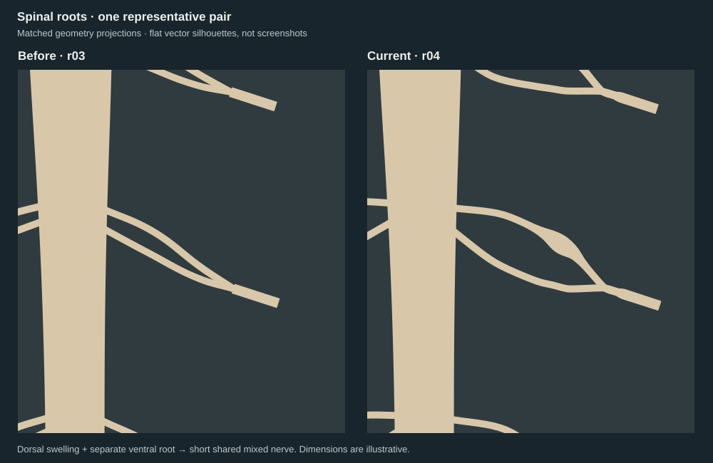

# Spinal roots and dorsal ganglia — r04

**Code-native draft of the existing authored spinal-cord study.** This revision
makes the dorsal ganglion, separate ventral root and their distal mixed-nerve
union visible. It preserves the r03 cord, conus and non-neural filum exactly.



The image is a **flat SVG projection of the generated geometry, not a screenshot**.
The independent visual review inspected matched, neutral-shaded Cycles PNGs.
The GLB and reviewed PNGs remain local build products; this package publishes
source code, SVG projections and receipts. It does not deliver a new binary or
change the existing gallery/model selection. Whole-model status remains **Needs
revision**; no quality-count increase is claimed.

- 17 bilateral illustrative samples; **not a complete 31-pair nerve map**.
- Ganglion belongs to the dorsal root; the ventral root remains unswollen.
- Rootlets, distal rami, meninges, vessels and vertebrae remain omitted.
- Paths, spacing, colors and dimensions are authored teaching choices. No
  vertebral registration, patient reconstruction, clinical or runtime approval.
- Some lower roots overlap in the chosen view; inspect the pair close-up.

本版显示背根神经节、独立腹根与其远端汇合的混合性脊神经。17个双侧示意层位
不是完整31对脊神经图谱；不代表临床尺寸或椎骨定位。生成的GLB和已审阅PNG尚未发布。

## Reproduce locally

Requires Blender **4.3.2** and the existing hydrated r03 baseline. No downloads or
uploads are performed by these scripts. Run from the repository root; every
output directory must be new.

```sh
blender --background --factory-startup --python-exit-code 1 \
  --python models/spinal_cord/exports/authored-roots-r04/build.py -- \
  --baseline models/spinal_cord/exports/authored-relationships-r03/spinal_relationships.glb \
  --out /tmp/spinal-r04-build

blender --background --factory-startup --python-exit-code 1 \
  --python tests/spinal_cord/authored-roots-r04/render.py -- \
  --baseline models/spinal_cord/exports/authored-relationships-r03/spinal_relationships.glb \
  --candidate /tmp/spinal-r04-build/candidate.glb --out /tmp/spinal-r04-renders

blender --background --factory-startup --python-exit-code 1 \
  --python tests/spinal_cord/authored-roots-r04/check_geometry.py -- \
  --candidate /tmp/spinal-r04-build/candidate.glb \
  --expected-sha256 a37783fbd1ad25ba9a2bcfbed1419a2d3f655b42cec643bf32a77266ca82a9d0 \
  --out /tmp/spinal-r04-geometry.json

blender --background --factory-startup --python-exit-code 1 \
  --python tests/spinal_cord/authored-roots-r04/check_relationships.py -- \
  --candidate /tmp/spinal-r04-build/candidate.glb \
  --record /tmp/spinal-r04-build/build-record.json --out /tmp/spinal-r04-relationships.json

blender --background --factory-startup --python-exit-code 1 \
  --python tests/spinal_cord/authored-roots-r04/project.py -- \
  --baseline models/spinal_cord/exports/authored-relationships-r03/spinal_relationships.glb \
  --candidate /tmp/spinal-r04-build/candidate.glb --out /tmp/spinal-r04-projections
```

A pointer-only checkout must obtain the already-published baseline through an
approved existing route before building. No new payload is fetched here.
Expected output: **2,663,288 bytes, 104 meshes, 178,960 triangles**, SHA256
`a37783fbd1ad25ba9a2bcfbed1419a2d3f655b42cec643bf32a77266ca82a9d0`.
A fresh local replay reproduced these bytes exactly. Build identity,
geometry checks, source screening, actual-pixel review and runtime remain
separate claims; see the [review receipt](../../../../reviews/spinal_cord/2026-10-29-authored-roots-r04/README.md).

## Source and rights

The input is the repository's authored r03 geometry, SHA256
`5d9f0f88ff8498f611aea583e080558691d592a3ce50c89ecb847cf18b4d1471`.
Its [provenance and limitations](../authored-relationships-r03/README.md) remain
unchanged. New roots are procedurally authored, not copied or segmented from a
third-party model. No separate public license for this authored package is
asserted; no reference artwork, PDF or photograph is included.

References read 2026-10-29:

- [Dartmouth, Chapter 41 — Nerve roots](https://humananatomy.host.dartmouth.edu/BHA/public_html/part_7/chapter_41.html): dorsal swelling and union with the corresponding ventral root distal to that swelling. Supports the relationship, not these coordinates.
- [OpenStax, Anatomy and Physiology 2e §13.4](https://openstax.org/books/anatomy-and-physiology-2e/pages/13-4-the-peripheral-nervous-system): sensory dorsal roots, motor ventral roots and mixed spinal nerves. Used for terminology only; no micrograph copied.

## Iteration

V1 made the relationship visible but had angular ganglion shoulders and a cuff at
the union. Same-executor actual-pixel review immediately identified both. V2 uses
a smooth radius profile and a tapered trunk entrance; both defects passed the
focused review. No further anatomy or quality gate is inferred.
