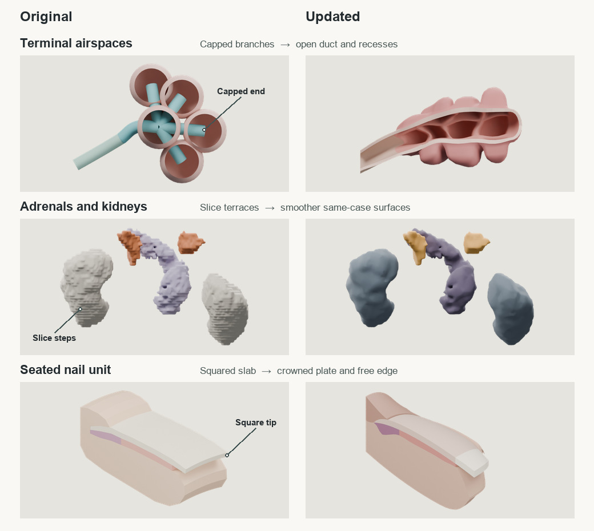

# Three surfaces in the body-systems gallery

20 November 2026 · Local review of eleven body systems

The terminal cutaway now shows where air can pass. The s1233 adrenal group keeps the shape and placement of the glands while shedding 81.5% of its triangles. The seated nail exposes the relationship between a crowned plate, its bed and the free edge. All three met the original overview rubric. A [later adrenal close-up review](../../endocrine-locator/adrenal-study-r04/README.md) reopens the surface score and compares an interpreted exterior. The scores below record the first review.

| Teaching asset | Fidelity | Form and surface | Teaching readability | Mesh economy | Total / 16 |
| --- | ---: | ---: | ---: | ---: | ---: |
| Terminal airspaces | 2 → 3 | 1 → 3 | 2 → 4 | 2 → 4 | **7 → 14** |
| s1233 adrenals | 3 → 3 | 1 → 3 | 2 → 3 | 1 → 4 | **7 → 13** |
| Seated nail | 3 → 4 | 1 → 3 | 2 → 3 | 2 → 3 | **8 → 13** |

The views are fresh Blender renders from clean GLB imports. Each pair shares camera, orthographic scale, lighting and exposure. The airspace and nail originals use native materials. The earlier gallery used brighter display colors and showed the nail lifted. The main nail comparison uses the seated pose on both sides. Each row above uses the same crop for both models.

## Terminal airspaces

Follow air through the bronchiole into a shared duct and its recesses.

| View | Original | Updated |
| --- | --- | --- |
| Isometric |  |  |
| Orthographic |  |  |

| Axis | Original → updated | Reason |
| --- | ---: | --- |
| Fidelity | 2 → 3 | The original names the airway sequence, but solid tube ends occupy the cup interiors. Eight centerline spans and eleven sampled openings clear the revised tissue. The number, spacing and sizes of the pockets are authored. |
| Form and surface | 1 → 3 | The cups now share a cut wall and their openings vary in depth. A second pass rounded and staggered the exterior. Some edges still facet at higher zoom, and the row of pockets remains visibly schematic. |
| Teaching readability | 2 → 4 | In the straight view I could follow the channel from left to right and identify the dark recesses on either side of a septum in grayscale. The oblique angle confirms that the recesses have depth. Some mouths on the far wall overlap. |
| Mesh economy | 2 → 4 | The original uses 6,734 triangles for eleven disconnected parts. The final uses 8,396 for four selectable regions sharing a continuous tissue shell. It uses 40.0% fewer triangles than a finer trial of the same design, with 99.89% and 99.86% silhouette overlap in the two views. |

[Updated GLB](../../../lessons/one-breath/terminal-study-r02/terminal-airspaces.glb) · [Sources and replay](../../../lessons/one-breath/terminal-study-r02/README.md) · [Per-part measurements](views/airspaces/metrics.json) · [Views and model hashes](views/airspaces/renders.json) · [Labeled grayscale section](views/airspaces/teaching-labels.png) · [Sampling trial](views/airspaces/sampling-comparison.json)

## Adrenals in their scan frame

Locate both adrenal glands relative to their respective kidneys and the intervening pancreas.

| View | Original | Updated |
| --- | --- | --- |
| Isometric |  |  |
| Orthographic |  |  |

| Axis | Original → updated | Reason |
| --- | ---: | --- |
| Fidelity | 3 → 3 | All five label identities and seven surface components survive, including both small pancreatic shells. The largest sampled two-way deviation was 1.189 mm against the r02 surface on a 1.5 mm grid. Direct agreement with the raw scan was outside this comparison. |
| Form and surface | 1 → 3 | The stepped edges of the kidneys recede. Both gland silhouettes remain distinct. The pancreas still shows localized angular ridges in the posterior view. |
| Teaching readability | 2 → 3 | The ochre glands separate from the darker kidneys and pancreas. Both are easy to locate from behind. In the grayscale oblique view, a kidney highlight competes with the edge of the nearer gland. |
| Mesh economy | 1 → 4 | 74,444 → 13,804 triangles at identical five-part scope. The GLB fell from 1,346,372 to 254,452 bytes. The first pass shrank the target glands by 7.34% and 6.48%. Restoring their volumes to within 0.001% left the overall maximum sampled deviation unchanged. The gland-specific worst samples rose to 1.152 and 1.157 mm. |

[Updated GLB](../../../assemblies/endocrine-locator/adrenal-study-r03/s1233-adrenals-teaching.glb) · [Sources and replay](../../../assemblies/endocrine-locator/adrenal-study-r03/README.md) · [Per-part measurements](views/adrenal/geometry.json) · [Views and model hashes](views/adrenal/renders.json)

## Seated nail unit

Trace the nail from the root under the fold, across the supporting bed and out to the unsupported free edge.

| View | Original | Updated |
| --- | --- | --- |
| Isometric |  |  |
| Orthographic |  |  |

| Axis | Original → updated | Reason |
| --- | ---: | --- |
| Fidelity | 3 → 4 | The original already passed two sampled plate-contact checks, which earns it credit here. The revised plate crowns in both axes and retains five named parts. Twenty samples across the fold, matrix and bed met the 0.0025 mm contact tolerance. The distal sample has 0.262 mm clearance in the illustrative frame. |
| Form and surface | 1 → 3 | The plate narrows toward a rounded free edge and the fingertip turns beneath it. A second pass removed the upturned far fold and smoothed the distal outline. The half-section still simplifies the far-side soft tissue. |
| Teaching readability | 2 → 3 | The straight view shows the darker proximal matrix, the bed beneath the plate and the gap at the tip. They remain identifiable in grayscale. The far-side margin is foreshortened in the oblique view. The optional lifted view exposes the bed. |
| Mesh economy | 2 → 3 | 2,416 → 4,076 triangles across the same five parts. Most of the increase goes to the digit contour and crowned plate. One extra material primitive distinguishes the free edge within the same shell. The full original GLB also carries a skin block, so whole-file byte savings would misstate the comparison. |

[Updated GLB](../../../models/skin/nail-study-r02/nail.glb) · [Sources and replay](../../../models/skin/nail-study-r02/README.md) · [Per-part measurements](views/nail/metrics.json) · [Views and model hashes](views/nail/renders.json) · [Lifted original](views/nail/original-lifted-iso.png) · [Lifted update](views/nail/updated-lifted-iso.png)

## Selection

I screened 103 isometric plates across all eleven systems, including the regional display revisions, both same-case overviews and the newer focused studies. Several plates show different states of the same asset. I then inspected both gallery angles of the three selected details and checked their owning recipes and exports.

| Teaching detail | Why it took priority |
| --- | --- |
| Terminal airspaces | Five near-identical cups and four capped branch ends visually suggest solid plugs inside the airspaces. This affects the central question of where air can pass. |
| Nail unit | The lifted plate makes the layers easy to count, but the constant-width slabs and flat cut edges give little sense of the plate wrapping the digit. The seated fit matters to the lesson. |
| Adrenals with kidney and pancreas context | Horizontal terraces remain visible around both kidneys even in a small posterior view. The two kidneys account for 49,472 of 74,444 triangles. Much of that detail describes the label grid. |

Other conspicuous examples included the arrows in the urinary outlet, the sparse nervous overview and the digestive outlet schematic. The urinary arrows are identified teaching cues, the nervous root has a dedicated junction detail, and the current gastroduodenal cutaway already exposes the opening. The selected three still showed a consequential defect in their closest available teaching view.

Use the [canonical scoring anchors and geometry guidance](../../../guideline/asset-quality.md) to repeat the review. Baseline source revision `53d17abd19386b3435da6e68ec796002a3333ea5`. Sol built the three derivatives. I selected the views, reviewed intermediate exports and assigned the scores after inspecting the final geometry checks and color and grayscale images.

## Verification and scope

All three GLBs reproduced byte-for-byte in independent builds. The owner checks rejected a missing airspace target, a wrong adrenal source and a combined skin block presented as the isolated nail. The gallery checked the image and model hashes, camera geometry and frame sizes before enabling the comparisons. In local Chrome all 334 gallery images decoded and all 45 static 3D launches opened. Part visibility and reset worked for all three new models. The browser run also exercised a failed model load and retry.

The repository gate passed 436 offline tests, checked 709 local LFS payloads and ran eleven package checks. A deliberately changed comparison image was rejected at the gallery receipt boundary.

The evidence supports these introductory tasks at the delivered viewing sizes. Specialist anatomical review and runtime performance measurement remain open. The source lessons, original scan surfaces and full original teaching assemblies retain their own uses. Keep the reviewed GLBs, paired evidence and source recipes together while this comparison is referenced.
