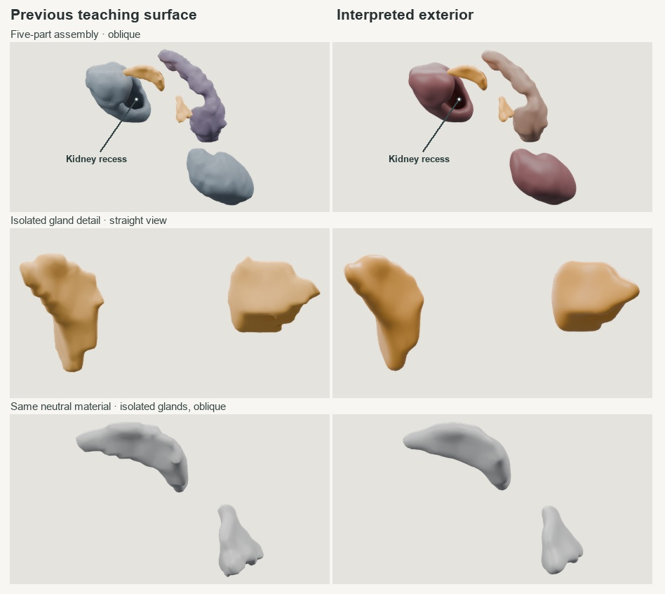

# Adrenal exterior for regional localization

The previous teaching surface preserved one tunnel through each adrenal and three through the main pancreatic surface. Its clean-import and volume checks passed. My original **3/4 for form and surface was too generous**. At gland close-up, steps and abrupt changes in curvature were visible, and the review had assigned no anatomical meaning to the tunnels.

The revised teaching model uses a smoother exterior, retains the glands’ separate silhouettes and fills all five tunnels. These closures are **editorial inferences**. For case-specific interpretation use the retained label-derived references. The kidney's dark medial recess is visible in both models. Both kidney shells are closed and have zero handles in both versions, so the recess and the five through-tunnels are different features. [Previous model](../../../assemblies/endocrine-locator/adrenal-study-r03/s1233-adrenals-teaching.glb) · [Updated model](../../../assemblies/endocrine-locator/adrenal-study-r04/s1233-adrenals-illustrative.glb) · [Source and replay](../../../assemblies/endocrine-locator/adrenal-study-r04/README.md)

**What should look soft?** At this scale, a broad change of direction across a thin gland is useful. Tight anonymous bumps that break up every highlight are distracting. A primary CT study of normal glands found varying configurations across serial sections. The University of Utah specimen shows the right adrenal in context with kidney, liver and surrounding fat. These references support the localization task and the importance of the limbs and silhouette. Neither measures the material or mechanical behavior of this case. The ochre targets and subdued context are an illustrative palette. [Normal adrenal CT study](https://pubmed.ncbi.nlm.nih.gov/670460/) · [Gross specimen](https://webpath.med.utah.edu/ENDOHTML/ENDO096.html)

## Reassessment

The task is to locate each gland above its ipsilateral kidney, then inspect its gross exterior. The oblique assembly and posterior view use the exported materials. Isolated views expose both gland outlines. Neutral-material pairs use the same override, lighting and camera on both models so that loss of fine relief can be judged independently of color. [Full-resolution views and hashes](renders.json) · [Scoring anchors](../../../docs/guides/asset-quality.md)

| Axis | Previous → updated | Reason |
| --- | --- | --- |
| Fidelity | 3 → 3 | The scan frame, sides, identities and kidney relationships survive. The inferred closures are disclosed. Their accuracy against the patient's tissue is unresolved. |
| Form and surface | **2 → 3** | At the same zoom the scalloped margin of the taller gland gives way to a continuous turn into its narrow end. The neutral comparison shows that the geometry changed. The broader gland still has a blunt, flattened inferior profile. |
| Teaching readability | 3 → 3 | Both glands remain individually selectable and visible from behind. In the oblique grayscale view the near gland still meets a kidney highlight. |
| Mesh economy | 4 → 3 | The previous surface had a measured reduction trial. The new model spends more triangles on the targets and fewer on kidney context. The delivered budget is reasonable. Its closest useful view has yet to be compared with a lighter sampling of this same reconstructed surface. |

Both revisions total **12/16** under the clarified rubric. The old version falls below the per-axis target for surface quality. The interpreted exterior meets the target on each axis. The unchanged total illustrates why the decision uses individual scores.

The highlight change is measurable. In the left gland, the share of mesh edge length where adjacent faces meet at more than 20° falls from **18.9% to 4.4%**. In the right gland it falls from **17.6% to 4.3%**. This describes the delivered meshes’ abrupt turns. The matched close-ups show which turns mattered to the learner.

## Geometry and limits

The original segmentation grid has 1.5 mm spacing. Measurements below compare the actual updated GLB with the previous teaching GLB. They describe the cost of an editorial surface change in this frame. The reconstruction working grid is finer than the source. Its sampling interval adds no acquired anatomical detail.

| Principal shell | Triangles before → after | Typical separation¹ (mm) | Largest sampled separation¹ (mm) | Volume change |
| --- | ---: | ---: | ---: | ---: |
| Left adrenal | 1,264 → 1,650 | 0.75 / 0.56 | 2.22 / 1.35 | -0.42% |
| Right adrenal | 1,132 → 1,550 | 1.04 / 0.69 | 2.34 / 1.46 | -0.30% |
| Left kidney | 4,170 → 3,650 | 1.29 / 1.04 | 3.12 / 2.58 | -0.16% |
| Right kidney | 3,744 → 3,650 | 1.30 / 1.05 | 2.75 / 2.43 | -0.19% |
| Pancreas | 3,382 → 3,348 | 1.19 / 0.71 | 7.12 / 1.72 | -0.28% |

¹ Each pair gives previous → updated and updated → previous distances to the nearest triangle. “Typical” is the 95th percentile of the samples. The small volume change conceals a **7.12 mm** local difference on the pancreatic shell. Use the updated model for regional localization. Case-specific boundary measurements require the source data.

The two secondary pancreatic pieces survive unchanged. Across all seven shells the export goes from 13,804 to 13,960 triangles and from 254,452 to 258,696 bytes. The clean import found no new surface intersections. Each mesh carries its source identity and number of inferred closures. [Per-part measurements and checks](geometry.json)

| Inspect full resolution | Previous | Updated |
| --- | --- | --- |
| Posterior assembly | [View](original-ortho.png) | [View](updated-ortho.png) |
| Isolated glands, posterior | [View](original-detail-ortho.png) | [View](updated-detail-ortho.png) |
| Isolated glands, oblique, neutral material | [View](original-neutral-detail-iso.png) | [View](updated-neutral-detail-iso.png) |

## Where the gland tunnels went

The posterior locator marks two sections through the actual exported triangles. Each crosshair sits on a straight line that passes through the old gland without hitting a face in either direction. The same point lies inside the updated gland. The openings seen in these planes are smaller than the 1.5 mm source grid spacing. Their presence in the mesh is verifiable. Their anatomical meaning in this individual remains uncertain. [Section coordinates and exact contours](tunnel-sections.json) · [Replay the section check](../../../assemblies/endocrine-locator/adrenal-study-r04/section.py)

## Verification

The geometry-only replay reproduced the delivered GLB byte for byte. Clean import preserved five named objects and seven shells. The recipe rejected an incorrect parent model. The report loader rejected a modified poster. All eight view records bind the identified GLBs and 16 images.

The local gallery browser check decoded all 334 images across 11 systems and opened all 45 offered 3D scenes in WebGL, including the updated adrenal comparison. The missing-asset retry and keyboard orbit checks passed. The repository’s offline and hydrated payload-integrity gates passed. Anatomical review here covers gross placement and the interpreted surface for teaching. Case-specific tissue boundaries, material mechanics and specialist acceptance remain open.
