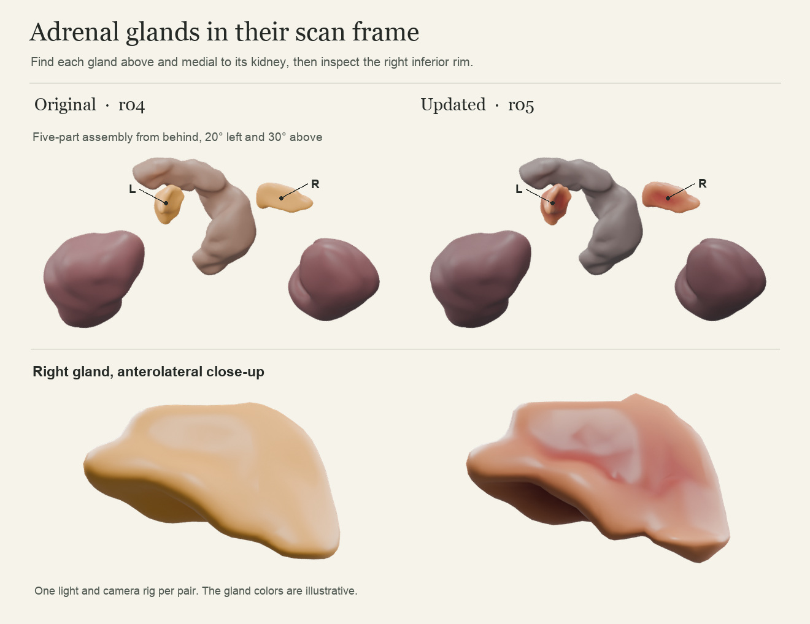

# Adrenal teaching surface · r05

[Compare the two surfaces before seeing the scores](compare.html). The comparison assigns the letters A and B on opening. Switch between the tissue finish and neutral surface at the same angle, inspect both glands, and then check their position in the regional view.

The task is unchanged from r04. Locate the left and right adrenal relative to the kidney on the same side, then isolate the glands and inspect their gross exterior. The preceding version removed small segmentation tunnels and steps but gave the broad right gland an ochre face with a blunt lower edge. The new model takes the gland surfaces back to the retained s1233 label-derived geometry. The warm capsule and restrained gloss are illustrative. [Previous review](../adrenal-study-r04/README.md) · [Asset, source and replay](../../../assemblies/endocrine-locator/adrenal-study-r05/README.md)

## Independent assessment

| Axis | r04 | r05 | What earned the score |
| --- | ---: | ---: | --- |
| Fidelity to evidence | 3 | 4 | The revision measures both gland surfaces and the superior and inferior extremities against the case reference. The five structure identities, laterality and regional frame survive export. A localized reconstruction also recovers the right inferior cleft across neighboring slices. The broader lower right edge is present in the labels. Keeping it costs some resemblance to a textbook triangle. |
| Form and surface | 3 | 4 | From the front and side, a recessed face turns into a curved lower rim. The turn remains under neutral material and reverse inspection. The finished model has warmth in the thicker areas, a broad soft reflection over the face and a narrower one across the rim. Gross specimen photography supports the distinction between a folded edge and a smooth face. |
| Teaching readability | 3 | 4 | In the default oblique view I could locate both glands above and medial to the same-side kidney by silhouette, including in grayscale. The stricter posterior view and the isolated glands confirm the two different profiles. The pancreas remains in the regional model. |
| Mesh economy | 3 | 4 | A 500-triangle right gland kept the coarse outline but introduced visible straight segments at the turning tip. On the 800 × 640 neutral close-ups, the largest contour differences were 2.00 pixels posteriorly and 2.24 pixels at the outer shoulder in the oblique view. |

**16/16 for the regional teaching task**, up from 12/16 under the same [scoring anchors](../../../guideline/asset-quality.md). The remaining aesthetic question is how polished a teaching gland should look. Its unbroken capsule still has a cleaner finish than the photographed specimen. The rubric rewards a discernible, reference-supported fold and finish at the teaching scale. Agreement with that art direction is what the blind pair lets you judge.

Mikael Häggström’s photograph shows the left gland from the front and the right gland from behind. Its broad faces, bent margins and interrupted moist highlights informed the finish. The photographed subject is a different person. The s1233 geometry supplies this model’s contour and the five inherited tunnel closures remain editorial. Its color, surface gloss and static shape cannot establish this patient’s actual capsule appearance or mechanical softness. [Specimen and teaching model side by side](specimen-comparison.jpg) · [Original gross specimen and view labels](https://commons.wikimedia.org/wiki/File:Adrenal_glands.jpg)

## Limits and measurements

Distances below are sampled from the original label-derived r02 triangles to the r05 triangles. The original grid spacing is 1.5 mm. The terminal values measure the greatest sampled change in each end slab.

| Gland | r02 → r05, p95 / max (mm) | Superior end max, r04 → r05 (mm) | Inferior end max, r04 → r05 (mm) |
| --- | ---: | ---: | ---: |
| Left | 0.96 / 2.11 | 3.08 → 1.79 | 1.89 → 1.28 |
| Right | 1.18 / 2.40 | 2.55 → 1.31 | 2.39 → 2.40 |

Both superior ends come closer to the retained labels, with the right inferior maximum staying within 0.01 mm of r04. The kidneys and pancreas retain their preceding geometry, including its documented 7.12 mm local pancreatic difference from r03. Use the teaching version for gross placement. For patient boundary work, use the underlying case data.

The 13,760-triangle five-part export is 286,832 bytes. It has 200 fewer triangles than r04 and costs 28,136 additional bytes, including the gland appearance data. The same-shape lighter test uses 500 triangles per gland and 103,040 bytes in total. The largest sampled differences on the right gland in the two directions were 0.27 and 0.30 mm. The pixel contour comparison above uses the alpha boundary at 50% coverage on the exact right-gland renders. [Geometry and localization checks](geometry.json) · [Render settings and image hashes](renders.json)

The most consequential correction was inside the right gland’s lower fold. An early r05 surface looked plausible from outside but shortened a cleft that persisted through neighboring case sections. At z = −67.35 mm the worst in-plane distance from a traced contour vertex in the cleft region was **5.97 mm in r04 and 0.64 mm in the delivered r05**. A fixed ray running into that opening first hits the case trace at 27.84 mm from its starting point, r04 at 18.69 mm and r05 at 27.34 mm. The receipt records nine neighboring planes, including three consecutive 1.5 mm label-grid centers. These are distances to the segmented case reference. In the lower terminal plate, the rounded exterior remains an editorial interpretation. [Case sections](case-sections.png)

| Axial plane, mm | −68.10 | −67.35 | −65.85 | −65.10 | −64.35 |
| --- | ---: | ---: | ---: | ---: | ---: |
| r02 trace → r04 contour, worst local mm | 6.19 | 5.97 | 6.14 | 6.21 | 6.55 |
| r02 trace → r05 contour, worst local mm | 0.59 | 0.64 | 0.70 | 0.60 | 1.05 |

The centroids of the left and right glands are respectively 47.05 mm and 77.72 mm above the corresponding kidney centroid in this scan frame. The primary view is 20° toward patient left and 30° above posterior. It exposes the left gland against more empty background, while the posterior view shows why the pancreas made it harder to identify from straight behind. [Grayscale check](grayscale.png)

## Verification

An independent replay reproduced the final GLB, lighter GLB and geometry measurements byte for byte. The replay rejected a wrong source and failed numerical subprocess. The plate builder rejected an altered render. The final Blender export reimported with five selectable structures. I opened the gallery’s default WebGL view and isolated the right adrenal, which rendered its expected 1,500 triangles. The browser lighting gives the glands a darker amber appearance than the studio plates. Use the matched plates to judge the finish and the live model to check the fold from another angle.

The local browser check decoded 334 images and launched all 45 available 3D scenes. It exercised the two gallery routes by keyboard, browser Back and reload, and opened every blind-comparison view from both disk and loopback. The exact-version builder also rejected an unrelated digest and a missing candidate. These checks cover this checkout and selected teaching task. Specialist review and patient-specific material measurements remain open.
