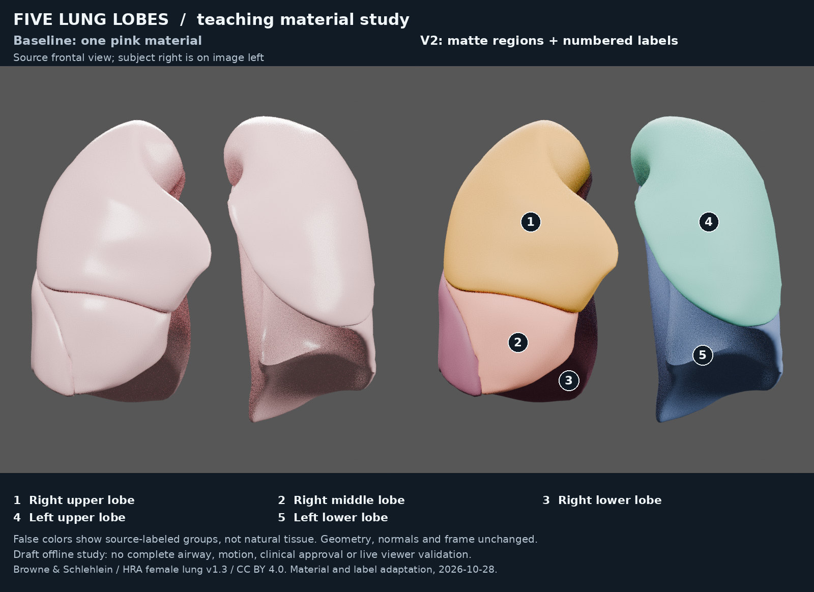
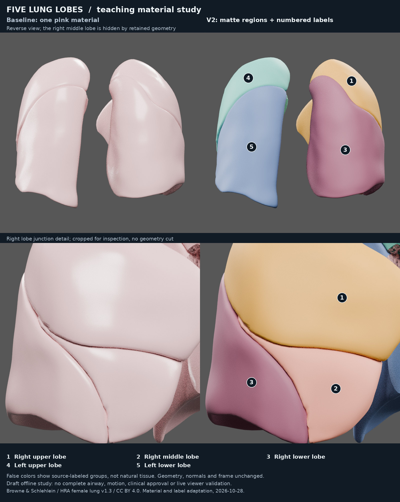

# Five-lobe identification study · draft v2

The existing single pink material leaves lobe identification dependent on prior
knowledge and subtle seams. This separate teaching variant assigns five matte
materials from the **existing lobe-parent hierarchy** and adds numbered labels
to matched offline plates. The source geometry, normals, transforms, hierarchy,
other materials and original reference remain intact. Labels are in the plates;
GLB extras alone do not display labels in a viewer.





These are Blender offline renders of actual GLBs, not browser screenshots.
Panels use matched cameras, scale, exposure, lights and all 56 source meshes.
The JPEG plates are compressed display derivatives of native 800px PNG panels.
Badges are placed only on visible lobe meshes, verified with image-pixel ray hits.
The reverse view intentionally has no middle-lobe badge: it is occluded, not
removed. The detail view labels only the three right lobes.

## Iteration and decision

- **v1:** five distinct source-labeled materials improved boundary identification.
  Actual context/reverse/detail inspection found broad glossy highlights competing
  with the region colors. Color alone also provided no reliable identity mapping
  in grayscale. Retained locally as an intermediate, not accepted as final.
- **v2:** roughness changed from the inherited `0.249303535` to illustrative `0.65`;
  numbered badges and a redundant written key identify all five frontal groups.
  Native export images and all three plates (including grayscale) were inspected.
  Glare is reduced, the small right middle region is identifiable, and the reverse
  and detail views preserve the same enclosing context and seams.
- **Author disposition:** retain v2 for bounded teaching review. Color is expressly
  false-color, not natural lung tissue or oxygenation. The preserved source seams,
  annotation boundaries and deep shading remain; this is not their repair.
  No independent visual reviewer or clinical/anatomical approval is claimed.

## Source and educational boundary

Kristen Browne and Heidi Schlehlein, 2023,
[HRA female lung v1.3](https://doi.org/10.48539/HBM794.PKQV.978),
[CC BY 4.0](../../../sources/datasets/hra/lung-female-v1.3/bounded-migration-2026-10-24/CC-BY-4.0.txt).
This material and label adaptation builds on the retained NORMAL-only r02
[baseline](../../../models/lung_pair/exports/hra-female-normals-r02/lung_female_hra_normals_r02.glb),
with the existing [source attribution](../../../sources/datasets/hra/lung-female-v1.3/bounded-migration-2026-10-24/ATTRIBUTION.md)
and [source crosswalk](../../../sources/datasets/hra/lung-female-v1.3/bounded-migration-2026-10-24/crosswalk.csv).
The untouched external raw HRA source remains referenced by its existing hash;
this work does not reacquire or overwrite it.

[NIH/NCI SEER anatomy](https://training.seer.cancer.gov/lung/anatomy/), consulted
2026-10-28, supports the naming/count scope: right upper/middle/lower, left
upper/lower, and lingula as part of the left upper lobe. It is a text reference;
no reference illustration was copied. Lobe membership here is direct provider
hierarchy evidence. Exact segment borders and every surface's anatomical validity
are **not** independently established by that general reference.

There are 25 recolored child meshes across five lobe groups, including the five
lobe-associated hilar patches; the two global hila and 29 airway/cartilage meshes
retain their source materials. All 56 component meshes retain the previously
documented open annotation boundaries; right tertiary cartilage warnings remain.
No larynx, trachea or main bronchi are supplied. No full airway, breathing,
whole-body registration, patient-specific or clinical claim is made.

## Identity and checks

| Artifact | Bytes | SHA-256 |
| --- | ---: | --- |
| Existing r02 baseline | 23,253,972 | `966a4c225be028e616f6f813e8d4232582995a82b8121a42257c1be53087cb19` |
| Retained glossy v1 | 23,257,076 | `fab70f09392d20fa0af2d91948a1b6006ac6e647eeae25ebd9604f0c29587186` |
| Matte v2 draft | 23,257,040 | `1b97cbe5ca765043962b77f3bcfd584679bf7174082b849aab676a39485612c0` |

Both variants retain **297,097 triangles / 56 meshes**. V2 adds 3,068 bytes to
the baseline; it is not a simplification or a measured runtime optimization.
Full BIN equality preserves position/normal/index bytes. The validator allows
only declared material assignments, five new materials and scoped extras;
the remaining JSON, including hierarchy and transforms, is recovered exactly.
Clean Blender imports independently compare geometry, corner normals and world
transforms. Imported material names, colors and roughness are also checked.
The retained cartilage uses linked vertex-color material graphs; those graphs
are compared to the clean baseline import. An early audit incorrectly checked
their unused socket defaults and failed. The corrected audit passes without a
model edit; its failed receipts are preserved. Future audits must inspect linked
material inputs rather than mistake an unused default for effective color.

[Evidence receipt](evidence.json) binds the exact models, nine rendered frames,
matched cameras, anchor witnesses and comparison hashes. Native PNGs, GLBs,
full import signatures, grayscale plate and v1 stay in the external local draft
directory; they are not Git/LFS payloads. Two small color comparisons are included.

Technical checks and author visual review do not establish anatomical approval.
**Live WebGL and intended-consumer label/material behavior are unrun.** The offline
scope is complete for the stated recipe; runtime remains `unverified`. There is
no Site publication, canonical promotion, LFS upload or merge in this change.

Author-local validation: seven focused failure-control tests pass normally and
with optimized Python; two actual v2 builds are byte-identical. Same-size source
corruption and existing output are rejected without changing retained files.
Plate checks reject changed camera poses, wrong frame hashes and existing output
directories. The repository's offline scope passes **174 tests**, 25 transport
manifests, 25 foundation records, 591 import references and 673 pointer identities;
that count does not represent media/render/runtime testing. The actual native
render and reimport checks above are separate. Hosted CI is not run locally.

## Replay

Use Python 3.11+, Blender **4.3.2**, Pillow (author run **12.3.0**) and the
system DejaVu fonts at the paths in `compare.py`. Output directories must be new.
The exact hydrated baseline must already be available; scripts make no network
requests. Ordinary offline tests need only Python and Git.

```sh
python3 tools/lung_lobes/build.py --source models/lung_pair/exports/hra-female-normals-r02/lung_female_hra_normals_r02.glb --revision v1 --output /tmp/lung-study-v1
python3 tools/lung_lobes/build.py --source models/lung_pair/exports/hra-female-normals-r02/lung_female_hra_normals_r02.glb --revision v2 --output /tmp/lung-study-v2
blender -b -t 8 --python-exit-code 1 --python tools/lung_lobes/render.py -- --baseline models/lung_pair/exports/hra-female-normals-r02/lung_female_hra_normals_r02.glb --candidate /tmp/lung-study-v1/lung-lobes.glb --revision v1 --output /tmp/lung-render-v1
blender -b -t 8 --python-exit-code 1 --python tools/lung_lobes/render.py -- --baseline models/lung_pair/exports/hra-female-normals-r02/lung_female_hra_normals_r02.glb --candidate /tmp/lung-study-v2/lung-lobes.glb --revision v2 --candidate-only --output /tmp/lung-render-v2
python3 tools/lung_lobes/compare.py --v1-renders /tmp/lung-render-v1 --v2-renders /tmp/lung-render-v2 --output /tmp/lung-comparison
python3 -m unittest discover -s tests -p test_lung_lobes.py
python3 tools/verify.py offline
```

The builder rejects wrong source bytes and existing outputs. Byte-identical model
replay is tested; exact render pixel replay across Blender platforms is not
promised. `render.py --audit-only` can check clean imports/material values without
repeating renders. Stop if any known check fails; an unavailable browser does not
turn a known offline defect into acceptance.
