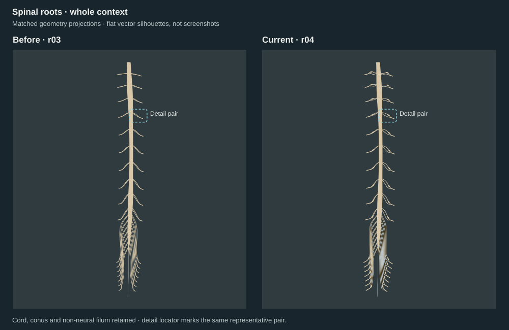
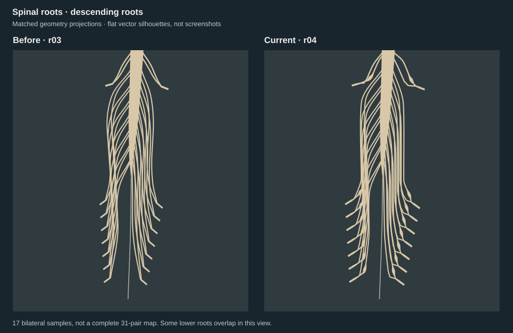

# Spinal roots — r04 review

**Substantial representative teaching improvement; draft source delivery.**
The dorsal ganglion and separate ventral root now converge into a readable mixed
nerve. Original r03 and its review remain unchanged. Related issue: #131.

These are **orthographic SVG silhouettes of exact imported GLB geometry, not
screenshots or Cycles renders**. Camera, scale and mesh hashes are bound in
[projection-bindings.json](projection-bindings.json). Flat fills and object-average
depth ordering omit surface shading and do not reproduce all raster occlusion.
The same-executor reviewer also inspected the exported SVG previews: labels and
same-pair locators were clear and unclipped. This is a separate presentation pass.

| Evidence | Result | Limit |
|---|---|---|
| Actual offline pixels | Independent pass with limitations; six matched PNGs | PNGs retained locally, not published; left lower overlap remains |
| Geometry/export | 104 closed single-component meshes; 68 cord attachments; no unrelated contacts in 5,151 pair screens | Finite-precision checks, not exhaustive self-intersection proof |
| Paired roots | 34 dorsal-only ganglia; 68 root/trunk contact candidate groups; ventral clearance at each ganglion | Authored geometry tolerances, not anatomical measurements |
| Preservation/replay | Cord/filum triangle identities preserved; exact GLB replay | Blender 4.3.2; no supported viewer test |
| Anatomy | Public-reference screening of the relationship | No specialist/clinical approval or full nerve map |
| Delivery | Recipe, SVG projections and text receipts | Generated GLB and reviewed PNGs remain local/unpublished |

[Independent actual-pixel verdict](independent-review.md),
[exact raster identities and cameras](raster-bindings.json), and
[technical result](checks.json) distinguish these claims. Local receipt names
identify retained files relative to the review workspace; they are not remote
artifact links. No private URLs or images are included.

Candidate SHA256:
`a37783fbd1ad25ba9a2bcfbed1419a2d3f655b42cec643bf32a77266ca82a9d0`.
2,663,288 bytes; 178,960 triangles. A fresh build reproduced the bytes exactly.

V1 completed at 06:03 UTC and was handed directly to the reserved reviewer.
The reviewer identified angular ganglion shoulders and a junction collar. V2 was
rendered at 06:05 UTC and immediately reviewed; the smoother profile and tapered
trunk entrance resolved both. Whole-model status remains **Needs revision**.

Use the [source package instructions](../../../models/spinal_cord/exports/authored-roots-r04/README.md)
for build, export, render and check commands. The original r03 baseline must be
hydrated locally; no new media transfer is part of this draft.
