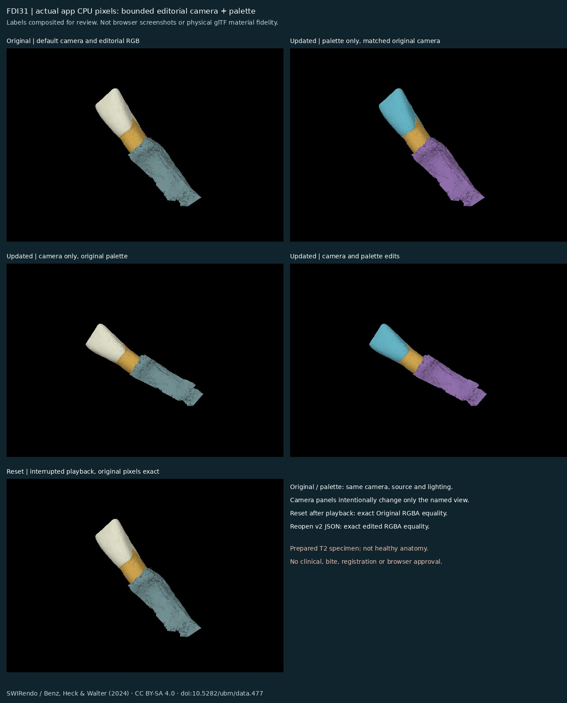
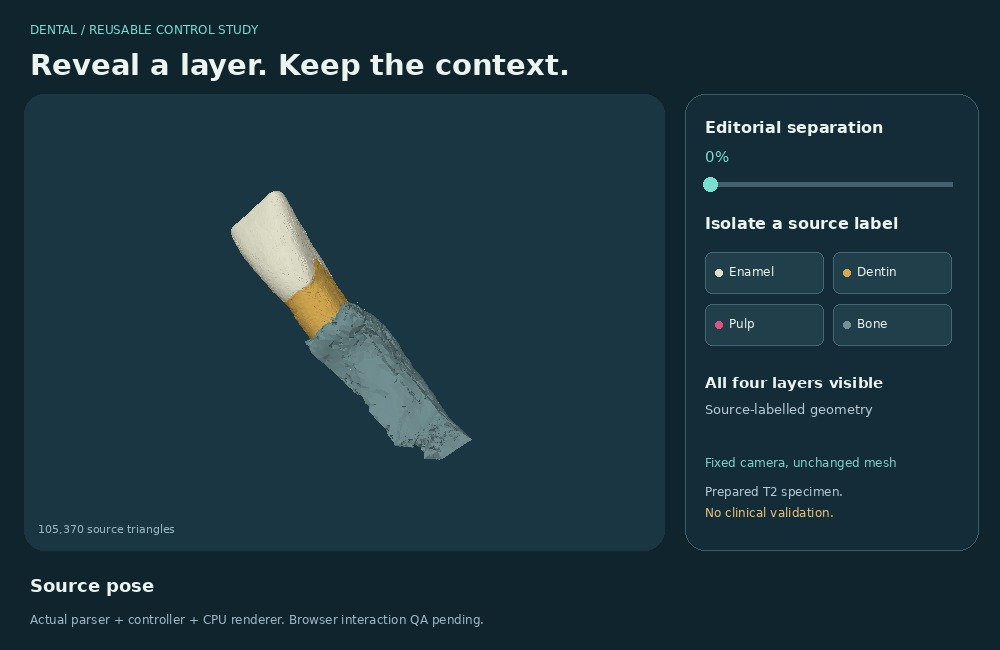
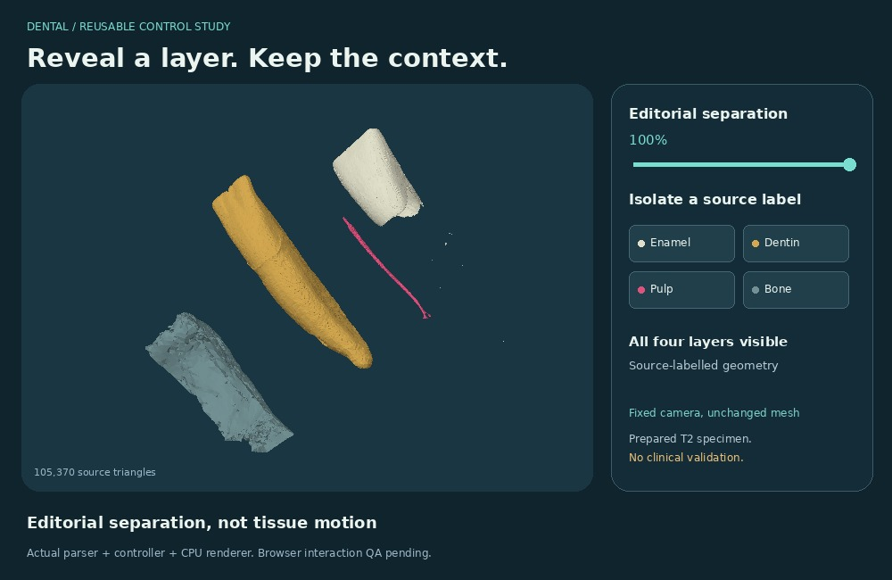
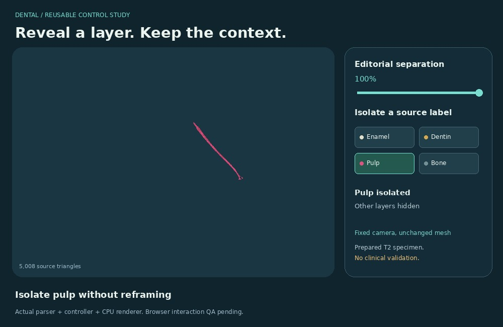

# Named reveal / isolate / reset controls

## Current private camera/palette increment



The current viewer adds **genuine bounded camera and opaque editorial RGB edits**.
These are actual app/parser/rasterizer pixels with review labels composited outside
the image, not browser screenshots. Original/palette panels use matched camera,
geometry and lighting. Camera panels intentionally change the view. Reset restores
Original pixels exactly after interrupted playback. Source meshes and the renderer
are unchanged. The historical sections below describe earlier increments.

- Native labelled number fields edit yaw ±π and pitch ±π/2 radians, zoom 0.5–1.5,
  and X/Y/Z target offsets ±0.25 of the fitted envelope extent. They commit on
  change/blur; a focused draft is not overwritten by playback renders. Four
  labelled colour inputs edit opaque integer RGB (0–255). No PBR, source glTF
  materials, textures, opacity, lighting or anatomical fidelity is implied.
- The target is the baseline source/reveal-envelope midpoint plus the three
  offsets times its extent. Source coordinates remain in metres. Resize recomputes
  the baseline extent and applies the same dimensionless offsets. Orbit/zoom can
  intentionally crop the view; Reset all returns the full baseline envelope.
- Valid edits pause at the last committed timeline sample. Invalid edits reject
  atomically without changing camera, palette, source state or playback. Errors
  are textual. Reset stops playback, resets the cursor, original transforms and
  visibility, and the independently copied baseline camera/colours. Queued RAF
  callbacks read the new state, never revive a stale presentation.
- JSON **version 2** adds editable `viewState` (camera and colours). `presentation`
  remains immutable baseline provenance, not the current edited palette.
  `recordedView` is a derived consistency check for the recorded viewport and
  viewState, not another independent editable camera. All source bindings remain
  strict. Version 1 fixed-view scripts load with defaults and save as v2; older
  v1-only viewers reject v2. Other versions or extra fields reject.
- The same existing `window.dentalAuthoring.save/load` and `script.cjs` /
  `build.py --script` workflow reopens v2 paused. Reset means the captured original
  source presentation, not a newly loaded edited state. Camera and palette are
  static editorial settings, not new timeline keyframe channels. Save/load UI,
  browser keyboard/layout/runtime and universal animated GLB export remain open.

Replay actual-app evidence with the already hydrated exact GLB (no download):

```sh
DENTAL_SOURCE=/path/to/FDI31-balanced.glb node tools/dental/layer-controls/render_presentation.cjs /tmp/presentation-evidence
python3 tools/dental/layer-controls/compose_presentation.py /tmp/presentation-evidence /tmp/presentation-review.jpg
```

The retained review sheet and `presentation-frames.json` bind the five actual-app
states, exact code hashes, source, raw pixel hashes and reset/reopen identity.
Raw RGBA buffers, generated HTML and sample JSON are replay outputs, not repeated
canonical source copies. Technical checks and independent review are recorded in
`review.json`. Browser/runtime and clinical gates remain unverified. No browser
restriction was retried or bypassed and no Site, PR, merge or asset was published.

## Historical baseline and increments





**New bounded implementation for #216.** #222 is the separate shooting-script and
Blender timeline proposal. This package adds manual control state and a
self-contained Canvas2D viewer; it does not replace that timeline or change a mesh.
The images/GIF are actual parser/controller/CPU-render pixels with a composited
control panel, **not browser screenshots**. [Preview GIF](media/FDI31-reveal-isolate-reset.gif).

## What works in the checked CPU scope

- Reveal is an absolute 0–1 display offset, never an accumulated transform.
- Isolate one of the four exact source labels. Other layers become invisible.
- Show all preserves the current reveal. Reset restores captured matrices and
  all-layer visibility exactly, including after repeated or mixed actions.
- A fixed camera encloses source and fully separated poses. Control changes do
  not reframe. Resize refits the full envelope, not the selected layer.
- The source SHA-256 must match before parsing or enabling controls. Bad input,
  missing Web Crypto, and setup failure leave controls disabled.

## Generic contract and BP3D smoke

`createController(parts, {labels, offsets})` now accepts an explicit nonempty,
unique source-label list and finite three-component editorial offsets. The same
implementation powers the unchanged default four-label FDI31 viewer. Parts must
match the contract exactly; missing, duplicate, unknown labels, malformed matrices
and invalid offsets fail before state creation. Labels, matrices and offsets are
captured by value. Resolve order follows the contract, not caller ordering.

The bounded Node adapter `bp3d-source.cjs` requires the exact hydrated BP3D r02
GLB and validates its 30 named, flat identity nodes against `bp3d-source.json`.
All 28 source-named teeth and two gingiva nodes exercise isolation and reset in
the same controller. BP3D offsets are deliberately zero: this proves named
selection, not a new tooth-explode animation. It does not connect BP3D to the
FDI31 viewer, register specimens or claim tooth-contact/bite validity.

```sh
BP3D_SOURCE=/path/to/hydrated/teeth_gums.glb \
  node --test tools/dental/layer-controls/bp3d-source.test.cjs
node --test tools/dental/layer-controls/named-controller.test.cjs
```

The real-source suite fails when bytes are absent, corrupt or unpinned; it does
not substitute a fixture or skip. Its source identity is SHA-256
`82bfaeead46bb51b1fa5bdfdb06c918dfd01aa23b28acae733ab75ec2cd6897f`,
814,328 bytes, canonical path `models/teeth_gums/exports/r02/teeth_gums.glb`.
Native frame: BP3D millimetres scaled .001, no translation. Rights and source
provenance remain in [BP3D attribution](../../../models/teeth_gums/exports/r02/ATTRIBUTION.md)
and `sources/datasets/bp3d-4.0-head-studies/external-source-map.json`.

Named-contract baseline evidence: 32 Node cases with both real GLBs (17 FDI31 controller/source,
5 actual-app DOM/RAF-double cases, 6 generic contract, 4 BP3D). A queued FDI31
render interrupted by reset reads the current state rather than reviving stale
selection. Repeated/manual interrupted reset does **not** establish timed playback
or scrub cancellation. The original historical review is retained in
[baseline receipt](review-fdi31-baseline.json); its code/HTML hashes describe
commit `1ffc4136cd9f064ea0e888709e656b2b3c3a7ada`, not this extension.

Still open in #216: browser playback/scrub runtime verification, editable camera/target and material-state
restoration, authoring/export reimport/replay support, and independent runtime
validation. No new anatomy, clinical or registration claim. The named-contract increment itself added no UI. The later timed UI increment is documented below. Existing
FDI31 screenshots remain historical evidence, not screenshots of a new BP3D UI.

## Replay

Requires Python 3.11+ and Node.js 18+. Preview compositing additionally needs Pillow.
The browser file has no external scripts, libraries, fonts or model fetches.

```sh
SOURCE=models/swirendo_fdi31/exports/balanced-20261028/FDI31-balanced.glb
PACKAGE=tools/dental/layer-controls
# SOURCE must be hydrated, not the LFS pointer. No tool here downloads it.
python3 "$PACKAGE/build.py" --source "$SOURCE" --out "$PACKAGE/output/FDI31-interactive-controls.html"
node --test "$PACKAGE/controller.test.cjs"                         # 15 pure state cases
DENTAL_SOURCE="$SOURCE" node --test "$PACKAGE/controller.test.cjs" "$PACKAGE/app.test.cjs" # 22 cases
node "$PACKAGE/render_preview.cjs" "$SOURCE"
python3 "$PACKAGE/compose_preview.py"
python3 tools/verify.py offline
```

The self-contained HTML is a review prototype. Open it in a supported browser
with Web Crypto and Canvas2D; local-file support and interaction remain unverified.
The companion downloaded source bundle supplies the same GLB as
`inputs/FDI31-balanced.glb`; use that path when replaying the bundle.

The offline repository gate runs the 15 default media-free state tests, the
6 generic named-contract cases and packaging checks. The 22-case command above additionally checks actual source byte/array
immutability, viewport bounds, and actual app event handlers with DOM/canvas/RAF
doubles. It is **not** browser E2E, keyboard, accessibility or performance testing.
The preview uses all 105,370 source triangles, including degenerate triangles
which do not draw. Prior Blender import evidence counted 105,346 after its
24 degenerate-triangle exclusions; no source geometry was edited here.

## Evidence and limits

[Review receipt](review.json) binds code, exact source and retained preview bytes.
[Frame states](preview-frames.json) record the continuous sequence and fixed camera.
The historical source and reset raw pixel buffers are identical. Independent source review
also checked desktop and 300 px-wide viewports; no source clipping was found.

Browser runtime is **unverified**. The available cloud browser could not reach
the workspace HTTP server, and its policy forbids file URLs. No alternative route
was used to bypass that restriction. No private Site was published. A supported
browser review should test slider input, all isolate buttons, show all, reset,
keyboard focus, narrow layout, and fail-closed errors before runtime acceptance.

The FDI31 viewer uses a source-specific GLB reader for the pinned specimen, not a general glTF
loader. The fixed-envelope method was checked for this source and is not a generic
no-cropping guarantee. There is no user camera manipulation, so reset means source
placement and visibility, not restoration of a user-moved camera. No material,
rig, cutting, deformation, procedure, clinical or physiological validation is implied.

## Source, rights and retention

SWIRendo A_1_31_T2_SEG_na, Benz, Heck and Walter (2024),
[dataset DOI](https://doi.org/10.5282/ubm/data.477),
[CC BY-SA 4.0](https://creativecommons.org/licenses/by-sa/4.0/).
The asset is the repository's Balanced simplified derivative of a prepared T2
FDI 31 specimen. It is **not healthy anatomy**; source defects remain visible.
Buccolingual orientation is unresolved. Enamel, dentin, pulp and bone are source
labels, not independent anatomical approval. Colours and separation are editorial.
Source-derived render assets remain CC BY-SA 4.0, with this attribution.

Canonical GLB: `models/swirendo_fdi31/exports/balanced-20261028/FDI31-balanced.glb`,
2,052,220 bytes, SHA-256
`90006e54c2b9f79f6c201397a50f92228d9ad6fa4450f20e0ad20c5fe70c19f7`.
The repository retains code, one GIF and compact review images for reviewers.
It does not duplicate the GLB or retain the 20 raw RGBA buffers / generated HTML.
The portable HTML embeds the unchanged source only in the delivered artifact,
so the recipient can inspect it without a network dependency. Historical #222
artifacts and original meshes remain untouched. Source-specific parser/rasterizer
code is reused from the private specimen explorer; only display state is new.

Next: inspect the prototype, then conduct an authorized browser review. This PR
is draft and partial #216 evidence; it does not close the issue or authorize merge.

## Private timed controller increment

The optional headless timeline API adds deterministic editorial shot timing in
milliseconds. That controller-only increment left HTML controls and renderer unchanged.
The later UI wiring below adds playback controls, without runtime approval. Call `setTimeline` with at least two
strictly increasing `{time, reveal, isolate}` frames beginning at zero. Reveal
interpolates linearly; named isolation is held until the next exact keyframe.
Every keyframe specifies both fields. Inputs are copied and validated before state
changes. Times and reveal values must be finite; scrub rejects out-of-range values.

`play()` starts/resumes, `tick()` samples an injected monotonic millisecond clock,
`pause()` samples then stops, and `scrub(milliseconds)` samples absolutely and
pauses. `playback()` returns position, playing and duration separately from the
unchanged manual `snapshot()` contract. The default clock is `performance.now`.
There are no timers owned by the controller: a caller drives `tick` from its own
scheduler. Late ticks after pause/reset have no effect. At the end playback stops;
playing again restarts at zero. Calling play while playing does not reset the clock.

Every successful manual dispatch stops playback and preserves existing manual
semantics. Manual actions retain the last timeline cursor; explicit play resumes
from that cursor and reapplies its scripted state. Reset stops playback, returns
the cursor to zero and restores original matrices/all visibility, irrespective of
what the first keyframe says. A replacement timeline stops and samples its first
frame. Invalid actions leave both manual and playback states unchanged.

Run `node --test tools/dental/layer-controls/timeline.test.cjs` for eight fake-clock
cases against the actual controller (nine with DENTAL_SOURCE, including timed
source-transform reset/immutability). The combined actual-source command with
`timeline.test.cjs` added passes 41 cases; the offline gate passes 338 tests and
requires the eight media-free timeline cases. This is
technical state evidence only: no new preview, physiological motion, material or
camera restoration, export/reimport, or browser approval. #216 remains partial.

## Private timed UI integration

The actual offline app now connects the reviewed controller API to native Play,
Pause and Sequence position controls. An 8-second editorial shot holds source pose
(0–1 s), separates all layers (1–3 s), holds separation (3–4 s), isolates pulp
(4–5 s), shows all and restores source placement (5–7 s), then holds (7–8 s).
Reveal interpolates; visibility changes at exact keyframes. The fixed camera,
renderer, source geometry and illustrative colours are unchanged.

Playback never starts automatically. The cursor and a textual playback status
are visible; the slider has a label, help text and seconds-based value text.
Scrub is absolute and pauses. Manual reveal/isolate/show-all pauses; explicit Play
reapplies the script at the retained cursor. Pause samples the current clock.
Reset stops and returns to zero/source pose; queued callbacks read current state,
so they cannot revive a stale frame. End stops at 8 seconds; Play then restarts.
The changing clock is not a live region. Native keyboard and screen-reader
behavior still require an actual supported-browser review.

Run all five Node suites with DENTAL_SOURCE and BP3D_SOURCE set to the exact
canonical hydrated GLBs: controller, app, named-controller, bp3d-source and timeline
(`node --test tools/dental/layer-controls/*.test.cjs`). This increment passes 45
cases, including nine actual-app cases using DOM/Canvas/RAF doubles and a fake
clock. The tests use the real renderer and source arrays, not a replacement mesh.
Generated HTML embeds the actual updated scripts and hash-verified source.
No new rendered UI screenshot exists; layout, browser scheduling, keyboard,
assistive technology and file-origin behavior remain unverified. Historical
preview images are not images of these controls. The preserved controller-only
receipt is `review-timeline-baseline.json`. No #216 camera/material/export
acceptance, browser approval, anatomy claim or publication is implied.

## Private source-bound JSON authoring and reopen

The supported authoring/export path is now a versioned JSON shooting script plus
this exact offline viewer, **not an animated GLB, Blender scene or universal glTF
consumer contract**. Existing GLBs, source arrays and renderer code are unchanged.
The new `authoring.js` adapter supports only the pinned FDI31 specimen. The generic
BP3D controller smoke remains separate; this is not a BP3D script interchange.

```sh
PACKAGE=tools/dental/layer-controls
SOURCE=models/swirendo_fdi31/exports/balanced-20261028/FDI31-balanced.glb
node "$PACKAGE/script.cjs" create "$SOURCE" /tmp/shot.json
# Edit timeline keyframes: finite milliseconds beginning at zero, reveal 0–1,
# and isolate null or one exact source label. Every keyframe needs all three.
node "$PACKAGE/script.cjs" check "$SOURCE" /tmp/shot.json
python3 "$PACKAGE/build.py" --source "$SOURCE" --script /tmp/shot.json \
  --out /tmp/FDI31-authoring-controls.html
```

`create` refuses to overwrite an existing script. `check` and `build --script`
verify the actual source hash and script before producing a viewer. The viewer
rechecks both on opening, reparses the unchanged embedded source and starts
paused. JSON is data only: no script text is evaluated. Without `--script`, the
existing eight-second default is used. Edited scripts can change the duration,
reveal and named isolation; playback and scrub controls follow that duration.

For a running viewer's authoring API, `window.dentalAuthoring.save()` returns JSON
text for the **last committed controller** timeline position and manual state,
without advancing the clock to include unsampled elapsed time. A pending redraw
may not yet show that state; the view record uses the current viewport. `window.dentalAuthoring.load(jsonText)` validates
on a fresh controller before replacing live state and always pauses. Save this
text to a JSON file, then use the same `build --script` path to reopen it. The
manual snapshot and retained script cursor are distinct: Play reapplies the
script at the cursor, preserving the existing manual-interruption semantics.
No save/load buttons or browser download behavior are claimed in this increment.

The JSON binds the exact source SHA/size/path, source labels, editorial offsets,
native-coordinate and licence references, fixed presentation policy, the recorded
viewport and camera including its target (`center`), timeline and current state.
Only timeline, state and position are editable. Unsupported versions, changed
source/labels/offsets/palette/camera, extra keyframe controls, invalid timing and
out-of-range values reject before replacing live state. Loading an invalid
embedded script fails closed with disabled controls.

**Camera/material limit:** the renderer has no orbit, target or material editing
controls. It uses opaque editorial RGB, not imported glTF materials. Its recorded
camera and palette stay unchanged during replay/reset at the same viewport.
Reset restores transforms, all-layer visibility and cursor and stops playback;
camera/material restoration is an invariant/no-op, not restoration after editing.
Resizing recomputes the fixed source-plus-reveal envelope for the current viewport.
The saved camera validates the recorded viewport; reopening at a different size
refits this fixed policy instead of restoring old screen dimensions. This does
not satisfy editable camera/material restoration in #216.

Technical evidence: six required media-free authoring cases and twelve actual-app
cases (54 total Node cases with both exact GLBs). The actual app tests reparse
source bytes, reopen edited scripts, resume playback, reject invalid live/embedded
scripts, interrupt queued playback with load/reset, and compare exact CPU pixel
buffers for saved/reopened and source/reset states. These use the unchanged real
renderer with DOM/Canvas/RAF doubles. Browser file-origin, keyboard, layout,
performance and actual browser save/reopen remain **unverified**. The small heading
and help-text changes avoid hard-coding the default shot when a custom script is
loaded; no new browser screenshot or visual UI approval is claimed.

The previous timed UI receipt is retained as `review-ui-baseline.json`. The current
receipt separates these technical results from historical preview pixels and
unverified browser/anatomy gates. #216 remains partial; no publication or merge.
